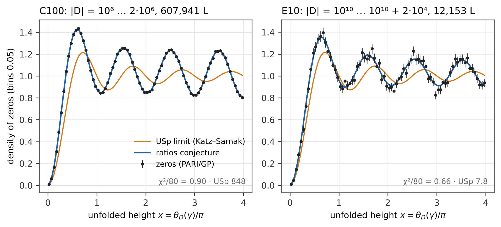

# 1. Introduction

The first two studies of this series [1, 2] compared the statistics of the Riemann zeros with formulas of Berry, Bogomolny and Keating that carry the primes as periodic orbits. Berry and Keating [3] close their review with the families of L-functions, for which Katz and Sarnak [4, 5] predicted that the zeros near the central point follow one of the classical compact groups: for the quadratic Dirichlet L-functions $L(s, \chi_D)$, $\chi_D(n) = (D/n)$, the unitary symplectic group USp. Özlük and Snyder [6] and Rubinstein [7] proved the one-level density of this family for test functions of restricted support, and Rubinstein [7] compared it with numerical zeros. The approach to the limit is slow: at finite conductor the density near the central point is well above the USp value, and the ratios conjecture of Conrey, Farmer and Zirnbauer [8] in the form worked out by Conrey and Snaith [9] gives the lower-order terms; Miller [10] tested it for this family.

This study measures these statements on eleven families of quadratic L-functions from $|D| \approx 10^3$ to $10^{10}$ (Section 2): the one-level density against the ratios conjecture and the null models (4.1), the slow approach to USp (4.2), the question why families of consecutive discriminants give a $\chi^2$ below that of independent L-functions (4.3), whether balancing residue classes reproduces it and how the sums of characters predict it without zeros (4.4), and the distribution of the first zero (4.5). The ratios conjecture, the Katz–Sarnak limit and the use of an effective matrix size [11, 12] are known; the contribution is the systematic, reproducible test on 795,381 L-functions with null models and an independent check, the mechanism behind the low $\chi^2$ of consecutive families, measured by frequency and predicted from the character sums, and the different behaviour of even and odd characters at the first zero. Section 6 separates what is new from what is confirmed.

# 2. Data

| family | discriminants | $L$-functions | zeros | computed on |
|------|------------------------------|----------:|----------:|------------|
| A | all with $10^3 < |D| \le 3\cdot10^3$ | 1,213 | 5,209 | computer 1 |
| B | $10^4 < |D| \le 2\cdot10^4$ | 6,074 | 26,355 | computer 1 |
| B10 | $10^4 < |D| \le 10^5$ (contains B) | 54,700 | 237,553 | computer 1 |
| C10 | $10^6 < |D| \le 1.1\cdot10^6$ | 60,795 | 264,063 | computer 1 |
| C100 | $10^6 < |D| \le 2\cdot10^6$ (contains C10) | 607,941 | 2,639,990 | computer 2 |
| D10 | $10^8 < |D| \le 10^8 + 10^4$ | 6,081 | 26,311 | computer 1 |
| D100 | $10^8 < |D| \le 10^8 + 10^5$ (contains D10) | 60,802 | 263,065 | computer 2 |
| E | $10^{10} < |D| \le 10^{10} + 2\cdot10^3$ | 1,206 | 5,201 | computer 1 |
| E10 | $10^{10} < |D| \le 10^{10} + 2\cdot10^4$ (contains E) | 12,153 | 52,355 | computer 2 |
| R | 6,000 random, $10^6 \le |D| < 10^7$ (seed 3462) | 6,000 | 26,031 | computer 1 |
| R10 | 60,000 random, $10^6 \le |D| < 10^7$ (seed 34620) | 60,000 | 260,183 | computer 2 |

$D$ runs over the fundamental discriminants of both signs; $D > 0$ gives an even character, $D < 0$ an odd one. In total 795,381 distinct L-functions with 3,452,121 zeros (876,965 L-functions and 3,806,316 zeros counted family by family, with the overlaps). The zeros were computed by one script, `ks_nuly.py` (PARI/GP 2.17.2 [13], `lfuncreate` and `lfunzeros`), up to the unfolded height $x = 4.3$, about four zeros per L-function, and stored in blocks with SHA-256; the random families use a fixed splitmix64 generator. The sets C100, D100, E10 and R10 were computed on computer 2 (macOS, 9 processes, about 33 CPU hours), the others on computer 1 (Linux, 2 processes). All 68,082 discriminants of C10, D10 and E and the 1,370 discriminants that the random families share with families of the other computer have identical zeros to the last stored decimal; B is identical within B10. A check without PARI confirms for every family that each fundamental discriminant occurs exactly once (own sieve for squarefree numbers) and that the zeros are positive and increasing; for 40 L-functions of the five large families the number of sign changes of the Hardy function (`lfunhardy`, a different PARI function) on a fine grid equals the number of stored zeros. The zeros themselves are not part of the publication; the generator, the manifests and the SHA-256 of the decompressed content of every block are.

# 3. Methods

**Unfolding.** For the completed function $(|D|/\pi)^{s/2}\Gamma((s + \kappa)/2) L(s, \chi_D)$, $\kappa = 0$ for $D > 0$ and $\kappa = 1$ for $D < 0$, the zeros $\frac12 + i\gamma$ are unfolded by $x = \theta_D(\gamma)/\pi$ with
$$\theta_D(t) = \frac{t}{2}\ln\frac{|D|}{\pi} + \operatorname{Im}\ln\Gamma\!\left(\frac{1/2 + \kappa}{2} + \frac{it}{2}\right),$$
so that the mean density is 1. Histograms of $x$ in bins of 0.025 up to $x = 4$ are kept for every L-function.

**Models.** The Katz–Sarnak limit is $W_{\mathrm{USp}}(x) = 1 - \sin(2\pi x)/(2\pi x)$. The finite matrix USp$(2N)$ with $N = \frac12 l$, $l = \ln(|D|/\pi)$, has $W_N(x) = 1 + \frac{1}{2N} - \sin((2N + 1)\pi x/N)/(2N\sin(\pi x/N))$. The ratios conjecture [8, 9] gives the density of the zeros in $t$ for one discriminant,
$$\rho_D(t) = \frac{\theta_D'(t)}{\pi} + \frac{1}{\pi}\operatorname{Re}\left[\frac{\zeta'}{\zeta}(1 + 2it) + A'(it) - \left(\frac{|D|}{\pi}\right)^{-it}\frac{\Gamma(\frac14 + \frac\kappa2 - \frac{it}{2})}{\Gamma(\frac14 + \frac\kappa2 + \frac{it}{2})}\,\zeta(1 - 2it)\,A(it)\right],$$
$$A(it) = \prod_p\left(1 - \frac{p^{2it} - 1}{p^2 - 1}\right), \qquad A'(it) = \sum_p \frac{\ln p}{(p + 1)(p^{1 + 2it} - 1)},$$
the arithmetic factors of the family of all fundamental discriminants (the proportion of $D$ divisible by $p$ is $1/(p + 1)$). This is the form of Conrey and Snaith [9, Theorem 3.1] adapted to this family; for odd characters, with the factor $\Gamma(\frac34 \pm \frac{it}{2})$, it is our analogue. The prediction for a family is the average of $\rho_D$ over all its discriminants, evaluated on a grid in $t$ with step 0.002 (mpmath, 30 digits; primes up to $2\cdot10^5$) and interpolated linearly in $l$ between nodes 0.002 apart; the pole terms at $t = 0$ cancel. A null model drops $A$ and $A'$.

**Statistics.** For bins of width 0.025, 0.05 and 0.1 the $\chi^2$ per bin uses the Poisson error of the observed count (Neyman's form; Section 4.6 compares it with Pearson's form, which takes the error from the expected count of the model, as in study II). Because the zeros of one L-function repel each other, the count in a bin varies less from one L-function to the next than a Poisson variable; independent L-functions around an exact model would give $\chi^2$ per bin of about 0.95, computed from the squared counts. A bootstrap over L-functions (200 resamplings with replacement) gives the band of $\chi^2$ from sampling noise alone and the probability of a value as small as observed; a test without bins uses the largest deviation of the cumulative count.

**Subsets.** To test the families of consecutive discriminants, B10, C100 and D100 are split into bands of 6,074 consecutive discriminants (sorted by $|D|$; the size of family B), and compared with random samples of the same size from the same family and with random samples stratified to the composition of the family in the classes (sign, $D \bmod M$), $M = 8, 24, 120, 840$ (Section 4.4 extends this to 19 moduli and to the sign alone, $M = 1$). For each subset the 80 deviations $r_b = (\text{data} - \text{prediction})/\text{error}$ in bins of 0.05 are decomposed by an orthonormal cosine transform, $c_k = \sum_b \sqrt{(2 - \delta_{k0})/80}\,\cos(\pi k(b + \frac12)/80)\,r_b$; $\chi^2$ per bin is $\sum_k c_k^2/80$, and index $k$ is the frequency $u = k/8$ in $x$. In the test with pieces a subset of 6,074 discriminants is assembled from $m$ consecutive pieces at random positions ($m = 1$: one stretch; $m = 6074$: a random sample). Every mean over random subsets is given with its error, the standard deviation of the subsets divided by the square root of their number.

**Character sums.** For each subset type the variance $V_p$ of the mean $\langle\chi_D(p)\rangle_{\mathcal S}$ over the subset (own Kronecker symbol, Euler criterion) is compared with the variance $\sigma_p^2/N\,(1 - N/n)$ of a random sample of $N$ from a family of $n$. For a stratification it is computed exactly, without draws: if $k_c$ of the $N$ elements are drawn without replacement from class $c$ of size $n_c$, mean $m_c$ and sample variance $S_c^2$, then $V_p = \sum_c k_c(1 - k_c/n_c)S_c^2/N^2 + (\sum_c k_c m_c/N - \mu_p)^2$; 300 draws per type confirm that random samples follow the finite population. The share that a subset keeps, $W = \sum_p w_p V_p(\mathcal S)/\sum_p w_p \sigma_p^2/N\,(1 - N/n)$ with the weight $w_p = (\ln p)^2/p$ of the explicit formula, is taken over $p \le 100$ ($W_{100}$) or over all primes of the low modes, $p \le e^{7L/8}$ ($W_E$). For consecutive bands the ratio $r_p = V_p(\text{bands})/(\sigma_p^2/N\,(1 - N/n))$ is computed for 582 primes up to $4\cdot10^6$ (vectorised Jacobi symbol). The line through two points of a family — random samples at $W = 1$ and consecutive bands at their $W$ — predicts the low-frequency power of every stratification without a parameter fitted to the stratifications; its $\chi^2$ takes into account that the two points are shared by all stratifications of a family (covariance matrix).

**First zero.** The distribution of the first unfolded zero $x_1$ is compared with $1 - E(0, s)$, $E(0, s) = \det(I - K)$ on $[0, s]$ with the kernel $S_N(x - y) - S_N(x + y)$, $S_N(z) = \sin((2N + 1)\pi z/(2N))/(2N\sin(\pi z/(2N)))$ (Gauss–Legendre, 40 nodes; the USp limit with $S(z) = \sin(\pi z)/(\pi z)$). Besides $N = \frac12 l$ an effective $N_{\mathrm{eff}}$ is used, chosen so that the density of USp$(2N_{\mathrm{eff}})$ in $[0, \frac12]$ equals that of the ratios conjecture for the same family — from the theory, not from the zeros — in the spirit of the effective matrix size of Bogomolny et al. [11] for $\zeta$ and Dueñez et al. [12] for elliptic curves. Kolmogorov–Smirnov distances are given with the critical value $1.36/\sqrt n$.

# 4. Results

## 4.1 The one-level density against the ratios conjecture

{width=95%}

| family | $\ln|D|$ | $\chi^2$/bin 0.05: ratios / without $A$ / USp | $p$ (bootstrap) | density in $[0, \frac12]$: data / ratios / USp |
|------|-------:|------------------|----------:|------------------------|
| A | 7.55 | 0.57 / 2.0 / 8.3 | < 0.005 | $0.772 \pm 0.036$ / 0.771 / 0.411 |
| B | 9.60 | 0.54 / 5.0 / 21 | < 0.005 | $0.708 \pm 0.015$ / 0.702 / 0.411 |
| B10 | 10.77 | 0.87 / 33 / 142 | 0.34 | $0.6718 \pm 0.0050$ / 0.6729 / 0.411 |
| C10 | 13.86 | 1.06 / 22 / 89 | 0.78 | $0.6136 \pm 0.0045$ / 0.6134 / 0.411 |
| C100 | 14.20 | 0.90 / 203 / 848 | 0.34 | $0.6082 \pm 0.0014$ / 0.6084 / 0.411 |
| D10 | 18.42 | 0.98 / 1.8 / 5.1 | 0.60 | $0.558 \pm 0.014$ / 0.560 / 0.411 |
| D100 | 18.42 | 0.77 / 12 / 49 | 0.10 | $0.5591 \pm 0.0043$ / 0.5595 / 0.411 |
| E | 23.03 | 0.71 / 0.80 / 1.2 | 0.04 | $0.531 \pm 0.030$ / 0.527 / 0.411 |
| E10 | 23.03 | 0.66 / 2.6 / 7.8 | 0.02 | $0.5273 \pm 0.0093$ / 0.5267 / 0.411 |
| R | 15.38 | 1.19 / 3.1 / 8.5 | 0.93 | $0.609 \pm 0.014$ / 0.593 / 0.411 |
| R10 | 15.37 | 0.90 / 18 / 72 | 0.37 | $0.5933 \pm 0.0044$ / 0.5925 / 0.411 |

The ratios conjecture describes every family (Figure 1, Figure 2): $\chi^2$ per bin 0.54–1.19 at bin width 0.05, where independent L-functions around an exact model give 0.95 and the bootstrap band is 0.70–1.24; the null models give up to 203 (without the arithmetic factor) and 848 (USp) in the largest family. The density in $[0, \frac12]$ agrees with the conjecture in all 33 combinations of family and sign within 1.2 standard errors; in C100 the error is 0.0014. The number of zeros up to $x = 4$ per L-function agrees as well (C100: 4.0103 against 4.0105; the USp limit gives 3.756). The same holds at the bin widths 0.025 and 0.1 and without bins (data files). Several families have $\chi^2$ below 0.95 — Section 4.3.

{width=95%}

## 4.2 The approach to the Katz–Sarnak limit

![Figure 3. Density of the zeros in $[0, \frac12]$ against $\ln|D|$: families (points), the ratios conjecture for one discriminant (lines; mean of the signs, $D > 0$ dashed, $D < 0$ dotted) and the USp limit 0.411; random families light blue.](../figures/03_approach_en.png){width=80%}

The density near the central point decreases from 0.772 at $|D| \approx 2\cdot10^3$ to 0.527 at $10^{10}$ and follows the ratios conjecture for one discriminant (Figure 3), which reaches the USp value 0.411 only slowly (0.504 at $\ln|D| = 28$). At $|D| = 10^{10}$ the data are $0.5273 \pm 0.0093$ — 12.6 standard errors above the limit. The limit of Katz and Sarnak is not in sight at these conductors; the lower-order terms of the ratios conjecture are.

## 4.3 Why consecutive families give $\chi^2$ below 0.95

The families A, B, E and E10 have $\chi^2$ per bin well below 0.95 (bootstrap probability below 0.005 for A and B, 0.035 and 0.02 for E and E10); B was the clearest case, 0.54 at bin width 0.05 and 0.45 at 0.1 (0.85 at 0.025), and below 0.65 for each sign. The deficit is largest for the widest bins — a first hint at low frequencies. The random families R and R10 are not below. To find out whether this is a property of consecutive discriminants, B10, C100 and D100 were split into bands of 6,074 consecutive discriminants and compared with samples of the same size (Figure 4).

{width=95%}

| family | subsets | $\chi^2$/bin 0.05 | $\chi^2$/bin 0.1 | power at $k = 1 \dots 7$ | power at $k = 32 \dots 79$ |
|------|--------------|-------------|-------------|--------------|--------------|
| B10 | 9 bands | $0.779 \pm 0.055$ | $0.686 \pm 0.058$ | $0.0098 \pm 0.0048$ | $0.540 \pm 0.049$ |
| | 81 random | $0.951 \pm 0.018$ | $0.861 \pm 0.023$ | $0.0433 \pm 0.0031$ | $0.622 \pm 0.016$ |
| | 81 with classes mod 840 | $0.936 \pm 0.018$ | $0.816 \pm 0.020$ | $0.0365 \pm 0.0030$ | $0.633 \pm 0.015$ |
| C100 | 100 bands | $0.913 \pm 0.015$ | $0.801 \pm 0.020$ | $0.0187 \pm 0.0014$ | $0.609 \pm 0.013$ |
| | 100 random | $0.976 \pm 0.017$ | $0.930 \pm 0.022$ | $0.0518 \pm 0.0029$ | $0.623 \pm 0.012$ |
| | 100 with classes mod 840 | $0.960 \pm 0.017$ | $0.897 \pm 0.021$ | $0.0447 \pm 0.0027$ | $0.604 \pm 0.012$ |
| D100 | 10 bands | $0.973 \pm 0.059$ | $0.888 \pm 0.068$ | $0.0246 \pm 0.0034$ | $0.635 \pm 0.045$ |
| | 30 random | $0.956 \pm 0.029$ | $0.907 \pm 0.040$ | $0.0517 \pm 0.0054$ | $0.601 \pm 0.025$ |
| | 30 with classes mod 840 | $0.949 \pm 0.030$ | $0.905 \pm 0.034$ | $0.0443 \pm 0.0059$ | $0.610 \pm 0.030$ |

In B10 and C100 the consecutive bands are below the random samples by 3.0 and 2.8 standard errors in $\chi^2$; in D100 there is no difference in $\chi^2$. The cosine decomposition shows where the difference sits (Figure 5): at low frequencies, $k = 1 \dots 7$ or $u < 1$, the bands have 0.23, 0.36 and 0.48 of the power of the random samples in B10, C100 and D100 (5.9, 10.2 and 4.3 standard errors), at high frequencies $k = 32 \dots 79$ there is no significant difference ($-1.6$, $-0.8$ and $+0.7$ standard errors). The total $\chi^2$ shows the effect only where the suppressed low frequencies are a large enough share of it.

![Figure 5. Left: mean power of the cosine transform of the deviations in C100 for consecutive bands (red), random samples (blue) and samples with the classes mod 840 (violet, dashed), as a running mean over three neighbouring $k$; vertical lines $u_c$ and $2u_c$. Right: power at $k = 1 \dots 7$ of subsets assembled from $m$ consecutive pieces at random positions, 400 subsets per point with $\pm 1$ error (filled); open circles the first run with 60 (B10) and 150 (C100) subsets per point, shifted slightly to the right — its apparent peak of B10 at $m = 1\,000$ is the scatter of a small number of random subsets.](../figures/05_spectrum_pieces_en.png){width=95%}

**Mechanism.** By the explicit formula, the deviation of the one-level density of a set $\mathcal S$ of discriminants from its mean contains, for every prime $p$, a term proportional to $\frac{\ln p}{\sqrt p}\langle\chi_D(p)\rangle_{\mathcal S}\cos(t\ln p)$, and from the prime squares a term with $\langle\chi_D(p)^2\rangle_{\mathcal S}$ and $\cos(2t\ln p)$. In the unfolded variable $t\ln p = 2\pi x\,\ln p/l$ (to leading order), so the prime $p$ acts at the frequency $u = \ln p/l$. For a stretch of consecutive discriminants of length $\Delta$ (in $|D|$), $\chi_D(p)$ depends on $D$ only modulo $p$ (modulo 8 for $p = 2$), and for $p < \Delta$ the average runs over nearly complete periods: it is of order $p/N$ instead of $N^{-1/2}$ for a random sample of $N$ discriminants; the same holds for the proportion of $D$ divisible by $p$. The fluctuations of the family density are therefore suppressed below $u_c = \ln\Delta/l$ (from $\chi_D(p)$) and partly up to $2u_c$ (from the prime squares). For bands of 6,074 discriminants $\Delta \approx 10^4$, and $u_c = 0.96$, 0.71 and 0.53 in B10, C100 and D100 — the suppressed range shrinks with the conductor, as observed. The periodicity of $\chi_d(n)$ in $d$ is the standard tool of mean-value theorems over discriminants [14, 15]. The closest published measurement is the murmuration of quadratic characters [16]: the average of $\chi_{8d}(p)$ over $d$ near $X$ depends only on $p/X$, tends to 0 as $p/X \to 0$ and changes near $p \approx X$, which the authors link to the transition at support 1 of the one-level density of a symplectic family [7, 17]. In this language $u_c = \ln\Delta/l$ is that transition for a family of length $\Delta$ instead of $X$ (our interpretation; made more formal in Section 4.6). Two tests, with a caution on random sampling:

* *Pieces.* A subset made of $m$ consecutive pieces of length $\Delta/m$ has $u_c = \ln(\Delta/m)/l$: the shorter the pieces, the fewer primes run over complete periods inside a piece. With 400 subsets per point the power at $k = 1 \dots 7$ grows with $m$ from 0.0095 ± 0.0004 ($m = 1$) to 0.0476 ± 0.0014 (random sample) in B10 and from 0.0206 ± 0.0008 to 0.0508 ± 0.0017 in C100, monotonically within the errors (Spearman rank correlation with $\ln m$ 1.00 in both; Figure 5, right); an independent repetition with other random positions gives the same. B10 reaches the random value later than C100 because the same piece has a higher limit $u_c$ at the smaller conductor ($l$ = 9.6 against 13.1; at $m = 300$, $u_c$ = 0.36 against 0.27), so the suppression reaches further into the low modes. At $m = 1\,000$ a small suppression probably remains in B10 (0.0428 ± 0.0004 against 0.0452 ± 0.0012 for random samples, means of four independent runs): a piece of about six discriminants still covers whole periods of $p = 2, 3, 5$.
* *Random sampling.* Every point is a mean over random subsets, and its error is the standard deviation of the subsets divided by the square root of their number. The power of a single subset scatters by 60–90 % of its mean (it is a sum of seven squared cosine coefficients), so with 60 subsets the error of a point is about a tenth of its value. The first run of this test, with 60 subsets per point in B10 and 150 in C100 (open circles in Figure 5), showed in B10 an apparent peak at $m = 1\,000$ (0.0477 ± 0.0046) followed by a drop to the random sample (0.0394 ± 0.0027), a fall of 1.5 joint errors between two neighbouring points. With 400 subsets per point the peak is gone (0.0439 ± 0.0013 and 0.0476 ± 0.0014), and four independent runs of 400 subsets give 0.0419–0.0439 at $m = 1\,000$ and 0.0421–0.0476 for random samples. A step between neighbouring points of a curve built from random samples is therefore a finding only when it is large compared with the errors of both points, and the random value of B10 is quoted as a mean with its error, not as a single run.
* *Residue classes.* Random samples with the composition of the whole family in the classes (sign, $D \bmod 840$) fix the averages of $\chi_D(p)$ only for $p = 2, 3, 5, 7$; they lower the low-frequency power by only 14–16 % (a fifth to a quarter of the deficit of the bands) and leave $\chi^2$ where the random samples are (Table). The effect is carried by the whole range of primes up to the length of the stretch, not by the smallest primes. Section 4.4 tests 19 moduli and the sign; with four to five times more samples there the reduction by $D \bmod 840$ is 18 % in B10 ($z = -5.1$) and not significant in C100 and D100.

**Family B.** In B10 the nine bands from $|D| = 10^4$ give $\chi^2$ = 0.54, 0.69, 0.69, 0.74, 0.70, 0.98, 0.95, 1.02, 0.70; the first is family B. It is the lowest band, 1.5 standard deviations below their mean 0.78: the general effect of consecutiveness at a small conductor plus an ordinary fluctuation. For the whole family B10 ($\Delta = 9\cdot10^4$) the suppressed share is smaller relative to the bootstrap band, and $\chi^2 = 0.87$ (probability 0.34). The effect is a property of how the family is chosen, not of the zeros of single L-functions: the random families, which sample the same range of conductors, show none.

## 4.4 Residue classes for 19 moduli and the sums of characters

Section 4.3 tested one stratification, (sign, $D \bmod 840$). To see whether any modulus reproduces the effect of consecutive bands, the test was repeated for 19 moduli — the primes and prime powers 3, 5, 7, 8, 9, 13, 16, 41 and 131 and the composite moduli 24, 40, 120, 130, 260, 360, 369, 520, 800 and 840 — and for the sign of $D$ alone ($M = 1$). All subsets of this section are new draws, independent of those of Section 4.3: a first pass with 81 / 100 / 30 samples per stratification and an independent repetition with other seeds and more samples (300 / 300 / 100 in B10 / C100 / D100) was made for the random samples, the sign and the moduli 3, 7, 8, 16, 41, 360, 520 and 840, and the prime 131 was added in a separate run of the same size.

| stratification | $W_{100}$ (B10 / C100 / D100) | B10 | C100 | D100 |
|---|---|---|---|---|
| random | 1 / 1 / 1 | 0.0440 | 0.0489 | 0.0499 |
| consecutive bands | 0.04 / 0.04 / 0.05 | 0.0098 ($-7.0$) | 0.0187 ($-16.2$) | 0.0246 ($-6.4$) |
| sign only | 1.00 / 1.00 / 1.00 | 0.0452 ($+0.6$) | 0.0490 ($+0.0$) | 0.0497 ($-0.0$) |
| $D \bmod 3$ | 0.96 / 0.96 / 0.96 | 0.0468 ($+1.5$) | 0.0508 ($+0.9$) | 0.0480 ($-0.6$) |
| $D \bmod 5$ | 0.95 / 0.95 / 0.95 | 0.0479 ($+1.0$) | 0.0510 ($+0.6$) | 0.0573 ($+1.3$) |
| $D \bmod 7$ | 0.94 / 0.94 / 0.94 | 0.0436 ($-0.2$) | 0.0508 ($+0.9$) | 0.0487 ($-0.3$) |
| $D \bmod 8$ | 0.98 / 0.98 / 0.98 | 0.0414 ($-1.5$) | 0.0480 ($-0.5$) | 0.0457 ($-1.4$) |
| $D \bmod 9$ | 0.96 / 0.96 / 0.96 | 0.0424 ($-0.5$) | 0.0493 ($+0.1$) | 0.0552 ($+0.9$) |
| $D \bmod 13$ | 0.94 / 0.94 / 0.94 | 0.0442 ($+0.1$) | 0.0485 ($-0.1$) | 0.0512 ($+0.2$) |
| $D \bmod 16$ | 0.98 / 0.98 / 0.98 | 0.0425 ($-0.9$) | 0.0518 ($+1.4$) | 0.0478 ($-0.6$) |
| $D \bmod 24$ | 0.94 / 0.94 / 0.94 | 0.0431 ($-0.3$) | 0.0503 ($+0.4$) | 0.0425 ($-1.4$) |
| $D \bmod 40$ | 0.93 / 0.93 / 0.93 | 0.0390 ($-1.7$) | 0.0464 ($-0.7$) | 0.0422 ($-1.4$) |
| $D \bmod 41$ | 0.96 / 0.96 / 0.96 | 0.0445 ($+0.3$) | 0.0505 ($+0.8$) | 0.0438 ($-2.0$) |
| $D \bmod 120$ | 0.89 / 0.89 / 0.89 | 0.0420 ($-0.7$) | 0.0506 ($+0.5$) | 0.0555 ($+0.9$) |
| $D \bmod 130$ | 0.89 / 0.89 / 0.89 | 0.0460 ($+0.6$) | 0.0531 ($+1.4$) | 0.0508 ($+0.2$) |
| $D \bmod 131$ | 1.00 / 1.00 / 1.00 | 0.0451 ($+0.6$) | 0.0505 ($+0.7$) | 0.0547 ($+1.2$) |
| $D \bmod 260$ | 0.89 / 0.89 / 0.89 | 0.0447 ($+0.2$) | 0.0526 ($+1.0$) | 0.0485 ($-0.2$) |
| $D \bmod 360$ | 0.90 / 0.89 / 0.89 | 0.0402 ($-2.1$) | 0.0468 ($-1.1$) | 0.0456 ($-1.3$) |
| $D \bmod 369$ | 0.93 / 0.92 / 0.93 | 0.0434 ($-0.2$) | 0.0551 ($+1.7$) | 0.0511 ($+0.3$) |
| $D \bmod 520$ | 0.88 / 0.87 / 0.88 | 0.0425 ($-0.8$) | 0.0476 ($-0.7$) | 0.0479 ($-0.6$) |
| $D \bmod 800$ | 0.94 / 0.93 / 0.94 | 0.0415 ($-0.8$) | 0.0479 ($-0.3$) | 0.0395 ($-2.4$) |
| $D \bmod 840$ | 0.84 / 0.83 / 0.84 | 0.0359 ($-5.1$) | 0.0462 ($-1.4$) | 0.0518 ($+0.6$) |

Power of the cosine coefficients $k = 1 \dots 7$ of subsets of 6,074 L-functions, mean over 81–681 (B10), 100–700 (C100) and 30–230 (D100) samples (all runs together; consecutive bands 9 / 100 / 10), in brackets $z$ = (stratification $-$ random) / joint error. $W_{100}$ is the exact remaining share of stratified sampling without replacement (Section 3), for all stratifications.

In C100 and D100 no stratification differs from the random samples beyond what 40 tests give by chance: beyond 2 standard errors are only D100 mod 800 ($z = -2.4$, 30 samples) and mod 41 ($-2.0$). In B10 the only clear reduction is $D \bmod 840$ ($z = -5.1$), followed by 360 ($-2.1$). Balancing $D \bmod 8$ or $D \bmod 16$, which fixes $\chi_D(2)$, is not decisive ($z = -1.5 / -0.5 / -1.4$ and $-0.9 / +1.4 / -0.6$), and the sign alone does nothing. A first run with 30 samples gave $0.0606 \pm 0.0073$ for D100 mod 840; with the repetition (130 samples) the value is $0.0518 \pm 0.0028$, as for random samples.

**Character sums without zeros.** Random samples have the variance of the means of $\chi_D(p)$ of sampling from a finite population within 0.4 % (median ratio 1.0011 / 1.0022 / 0.9960 over 300 draws). For a stratification by $M$ the exact variance of stratified sampling without replacement is at most 0.07 of the random value for the primes dividing $M$ (for $p = 2$ only when $8 \mid M$; the remainder is the rounding of the class counts) and 1.000–1.014 for every other prime. The share $W_{100}$ that a stratified subset keeps is therefore at least 0.83 for every one of the 20 stratifications (0.84 / 0.83 / 0.84 for 840; Table), against 0.04–0.05 for consecutive bands. The line through the two points of each family — random samples ($W = 1$) and consecutive bands — gives for all 60 stratified subsets $\chi^2 = 82.05$ with the covariance of the two shared points ($p = 0.03$; the central 95 % range for 60 degrees of freedom is 40.5–83.3), and for the 33 of the first version of this section $\chi^2 = 47.7$ ($p = 0.05$). The direction agrees: no stratification comes near the bands (Figure 6, left). The size agrees only at the edge: 42 of the 60 deviations are positive (mean $z = +0.56$), the stratifications lower the low-frequency power of the zeros a little less than the line predicts. A likely reason is that the line attributes the whole deficit of the bands to the primes up to 100, while the bands also suppress the primes between 100 and $10^4$ (profile below), which a modulus does not touch. Two checks: the slope fitted to the 20 stratifications alone, divided by the slope of the line, gives the share of the band deficit carried by $p \le 100$ as 1.09 ± 0.26, 0.53 ± 0.26 and 0.02 ± 0.54 in B10, C100 and D100 (jointly 0.72 ± 0.17) — it falls with the conductor, as the low modes are carried by ever larger primes, but only at the level of 1.5–2 errors; and equal weights $(\ln p)^2/p$ over all primes of the low modes ($W_E$, bands 0.18 / 0.53 / 0.75) remove the shift (mean $z = +0.02$) but overshoot in B10 ($\chi^2 = 91.0$, $p = 0.006$, B10 mod 840 4.1 errors below). The two axes come from different data — the zeros on one side, the values of the characters on the other — so the agreement in direction is an independent check of the mechanism of Section 4.3: a modulus fixes only the primes that divide it, while the low frequencies are carried by all primes up to the thousands; how the variance of $\chi_D(p)$ converts into low-frequency power is understood in direction, not in size.

![Figure 6. Left: exact remaining share $W_{100}$ of the weighted variance of the means of $\chi_D(p)$, $p \le 100$ (from the characters, without zeros), against the low-frequency power $k = 1 \dots 7$ of the zeros (from the zeros, without characters) for random samples (squares), the 20 stratifications (dots) and consecutive bands (diamonds) of B10, C100 and D100, with $\pm 1$ error; dashed the line through the two points of each family. Right: profile $r_p$ of consecutive bands of 6,074 discriminants (582 primes up to $4\cdot10^6$ in logarithmic bins); dashed the width $\Delta \approx 10^4$ of a band, dotted $e^{7L/8}$ for each family.](../figures/06_moduli_characters_en.png){width=95%}

**Conductor dependence.** The profile $r_p$ of consecutive bands is the same function of $p$ in the three families, whose bands all have the width $\Delta \approx 10^4$ in $|D|$: 0.04–0.05 for $p \le 100$, 0.12–0.17 up to $10^3$, 0.29–0.41 up to $10^4$, 0.84–0.90 up to $10^5$ and about 1 above (Figure 6, right). The mode $k$ is carried by primes with $\ln p \approx kL/8$, $L = \ln(|D|/\pi)$, i.e. up to $e^{7L/8} \approx 4\cdot10^3$, $9\cdot10^4$ and $4\cdot10^6$ in B10, C100 and D100; the $k$-weighted share $W_k = \sum_k k\,r(e^{kL/8})/28$ grows $0.22 \to 0.61 \to 0.70$, while the measured ratio of the low-frequency power of bands and random samples grows $0.22 \pm 0.11 \to 0.38 \pm 0.03 \to 0.49 \pm 0.07$. Order and direction agree; the size for C100 does not (7 errors). The conversion of the variance of $\chi_D(p)$ into the low-frequency power of consecutive bands is thus understood in its direction but not in its size.

## 4.5 The first zero

![Figure 7. Left: distribution function of the first zero in C100 minus USp$(2N_{\mathrm{eff}})$ for even (red) and odd (blue) characters; green the Kolmogorov–Smirnov critical value, dashed $x_1 = \frac12$ (the end of the interval on which $N_{\mathrm{eff}}$ is fixed), violet the crossing of the even curve with zero with its error (grid 0.001, bootstrap). Right: deviation of the mean first zero from USp$(2N_{\mathrm{eff}})$ against $l = \ln(|D|/\pi)$ in six non-overlapping families, with the fits $c/l$.](../figures/07_first_zero_en.png){width=95%}

USp$(2N)$ with $N = \frac12\ln(|D|/\pi)$ does not describe the first zero: its mean is 0.67–0.75 against the measured 0.58–0.70, and the Kolmogorov–Smirnov distance is 0.06–0.14, 1.6 to 53 times the critical value. The effective $N_{\mathrm{eff}}$ fixed by the ratios conjecture is 1.5–4.5, two to three times smaller than $\frac12 l$, and USp$(2N_{\mathrm{eff}})$ gives the mean first zero within 1.1 % in all families. Separating the signs with the errors of C100, B10, D100, E10 and R10 shows a difference (Figure 7):

| family | $l$ | even ($D > 0$): $x_1 - x_1^{\mathrm{eff}}$ | KS / critical | odd ($D < 0$): $x_1 - x_1^{\mathrm{eff}}$ | KS / critical |
|------|------:|------------------|------------|------------------|------------|
| A | 6.41 | $+0.0101 \pm 0.0095$ | 0.032 / 0.055 | $+0.0012 \pm 0.0096$ | 0.017 / 0.055 |
| B10 | 9.62 | $+0.0102 \pm 0.0015$ | 0.025 / 0.008 | $+0.0002 \pm 0.0015$ | 0.003 / 0.008 |
| C100 | 13.06 | $+0.0072 \pm 0.0005$ | 0.015 / 0.0025 | $-0.0005 \pm 0.0005$ | 0.0010 / 0.0025 |
| R10 | 14.23 | $+0.0073 \pm 0.0016$ | 0.014 / 0.008 | $-0.0010 \pm 0.0016$ | 0.003 / 0.008 |
| D100 | 17.28 | $+0.0038 \pm 0.0016$ | 0.008 / 0.008 | $-0.0002 \pm 0.0016$ | 0.003 / 0.008 |
| E10 | 21.88 | $+0.0013 \pm 0.0037$ | 0.006 / 0.017 | $-0.0017 \pm 0.0037$ | 0.006 / 0.018 |

For odd characters USp$(2N_{\mathrm{eff}})$ gives the whole distribution of the first zero within the errors at every conductor from $10^3$ to $10^{10}$ (in C100 the Kolmogorov–Smirnov distance is 0.0010 at the critical value 0.0025); the fit $c/l$ gives $c = -0.006 \pm 0.006$. For even characters the first zero lies higher: 14.8 standard errors in C100, 6.6 in B10, 4.6 in R10. The deviation decreases with the conductor and is fitted by $c/l$ with $c = 0.094 \pm 0.006$ ($\chi^2 = 2.1$ for 5 degrees of freedom); a constant shift gives $\chi^2 = 10.7$ and $c/l^2$ gives 7.6. Fitted on the families with $l < 15$, $c/l$ predicts 0.0055 for D100 and 0.0043 for E10, measured $0.0038 \pm 0.0016$ and $0.0013 \pm 0.0037$. One effective parameter is therefore not enough for both signs; the even characters need a correction of lower order, which the present data measure but do not derive.

**Where the even curve crosses zero.** On a grid of 0.001 instead of 0.02 the difference $F(x_1) - \mathrm{USp}(2N_{\mathrm{eff}})$ of the even characters of C100 changes sign at $x_1 = 0.508 \pm 0.021$ (bootstrap over the L-functions, 400 resamples; Figure 7 left); the even and the odd curve cross at $0.504 \pm 0.034$, and in B10 the crossing lies at $0.488 \pm 0.038$. Neither a pure shift of USp$(2N_{\mathrm{eff}})$ by the measured difference of the mean (0.0072) nor a change of scale with the same mean gives a crossing: the difference then has one sign everywhere. The position of the crossing, however, comes from the calibration and not from the zeros. $N_{\mathrm{eff}}$ is chosen so that USp$(2N_{\mathrm{eff}})$ has the density of the ratios conjecture in $[0, \frac12]$, hence the same expected number of zeros there (Section 3), and the data have it too (even characters of C100: 0.6303 against 0.6303). Since $P(x_1 \le a) = E[N(a)] - \sum_{k \ge 2} P(N(a) \ge k)$ for the number $N(a)$ of zeros in $[0, a]$, the two distribution functions then nearly agree at $a$, up to the terms of two and more zeros in $[0, a]$. Fixing $N_{\mathrm{eff}}$ on $[0, a]$ instead moves the crossing with $a$:

| calibration interval $[0, a]$ | $a = 0.3$ | 0.4 | 0.5 | 0.6 | 0.7 | slope |
|----------------------|-------:|-------:|-------:|-------:|-------:|-------:|
| C100: $N_{\mathrm{eff}}$ | 2.278 | 2.352 | 2.432 | 2.517 | 2.612 | |
| C100: crossing | 0.291 | 0.416 | 0.508 | 0.595 | 0.767 | 1.13 |
| B10: $N_{\mathrm{eff}}$ | 1.641 | 1.751 | 1.854 | 1.950 | 2.052 | |
| B10: crossing | 0.289 | 0.414 | 0.488 | 0.598 | 0.771 | 1.15 |

In every case the crossing lies at most 0.071 from $a$. That the crossing lies at $\frac12$ is therefore rejected as a property of the first zero: it marks the end of the calibration interval. What remains with the calibration at $\frac12$ is the shape: the even characters have more first zeros below $\frac12$ (peak $+0.0034$ at 0.36) and fewer between $\frac12$ and about 1.3 (minimum $-0.0152$ at $0.874 \pm 0.018$), which neither a shift nor a change of scale reproduces. In A, R10, D100 and E10 the positive part is within the noise and the crossing is not determined (0.30–0.36 ± 0.09–0.11). There is no second crossing in C100: the curve re-enters the Kolmogorov–Smirnov band at $1.341 \pm 0.009$ (B10: $1.183 \pm 0.017$, so the return depends on the conductor and is not $\frac32$), is still $-0.00063 \pm 0.00007$ at 1.5 and merges with zero only near the end of the model, $0.98\,N_{\mathrm{eff}} = 2.38$.

## 4.6 Exact expectations, layered estimates, balanced samples and the coupling of modes

With the error of every bin taken from the expected count of the family prediction (Pearson's form, as in study II), $c_k$ of a subset $\mathcal S$ of $N$ L-functions is the mean over $\mathcal S$ of fixed numbers $y_{ik}$, one per L-function, and its expected square over all subsets of a design is $\bar y_k^2$ plus the variance of the mean: $S_k^2/N\,(1 - N/n)$ for random samples, the same over the $\lfloor n/\ell\rfloor$ pieces for pieces of $\ell$ consecutive discriminants, $\sum_c k_c(1 - k_c/n_c)S_{ck}^2/N^2$ for stratification, and the exact average over all $n - N + 1$ starting positions for one stretch. This layer 0 needs no random numbers. The statistic of the test (error from the observed count, Sections 4.3–4.4) differs from it only a little; the difference is drawn on the same subsets (layer 1, 200 subsets) and refined where its error is largest (layer 2, at most 1,600 subsets, target error $2\cdot10^{-4}$). The difference scatters three to five times less than the statistic itself, and the error of every point falls 3.6 / 3.8 / 4.1 times (B10 / C100 / D100) against drawing the statistic alone; all designs use the same random numbers.

| design | B10 layer 0 | B10 estimate | C100 layer 0 | C100 estimate | D100 layer 0 | D100 estimate |
|------|------:|------:|------:|------:|------:|------:|
| random sample ($\ell = 1$) | 0.0443 | $0.0455 \pm 0.0002$ | 0.0488 | $0.0506 \pm 0.0002$ | 0.0479 | $0.0488 \pm 0.0002$ |
| triples ($\ell = 3$) | 0.0432 | $0.0443 \pm 0.0002$ | 0.0480 | $0.0493 \pm 0.0002$ | 0.0474 | $0.0485 \pm 0.0002$ |
| $\ell = 10$ | 0.0408 | $0.0420 \pm 0.0002$ | 0.0468 | $0.0485 \pm 0.0002$ | 0.0470 | $0.0480 \pm 0.0002$ |
| $\ell = 100$ | 0.0289 | $0.0300 \pm 0.0002$ | 0.0405 | $0.0418 \pm 0.0002$ | 0.0424 | $0.0432 \pm 0.0002$ |
| $\ell = 1{,}000$ | 0.0134 | $0.0143 \pm 0.0002$ | 0.0286 | $0.0299 \pm 0.0002$ | 0.0346 | $0.0352 \pm 0.0002$ |
| classes $D \bmod 840$ | 0.0369 | $0.0377 \pm 0.0002$ | 0.0456 | $0.0464 \pm 0.0002$ | 0.0469 | $0.0476 \pm 0.0002$ |
| one stretch (all starts) | 0.0079 | 0.0093 | 0.0185 | 0.0200 | 0.0292 | 0.0295 |

![Figure 8. Upper left: low-frequency power of subsets of 6,074 L-functions from randomly placed pieces of $\ell$ consecutive discriminants (line layer 0 without draws, filled layered estimate ±1 error, open draws only, right one stretch). Upper right: samples balanced on $\chi_D(p)$ for $p \le P$ (points ±1 error) and layer 0 from the regression (line); triangles $e^{kl/8}$. Lower left: correlation of the contributions of one L-function between the modes in B10. Lower right: increase of the explained share of the variance of every mode after adding $\chi_D(n)$ of 16 composite $n < e^4$, ticks the null model.](../figures/08_layers_en.png){width=95%}

**Pieces and triples.** The power falls with the length of the piece. Already triples of consecutive discriminants lie below random samples: 0.972 of the random value in B10 (4.7 standard errors) and 0.975 in C100 (4.3), as layer 0 predicts (0.976 and 0.983); in D100 the decrease (0.995) is below the resolution, because at a larger conductor the low modes are carried by larger primes, which three neighbours do not balance.

**The offset of a few per cent.** The test statistic lies above layer 0 by $0.0012 \pm 0.0002 / 0.0017 \pm 0.0002 / 0.0009 \pm 0.0002$ for random samples (2.7 / 3.5 / 1.9 %), and the difference is positive for all 30 designs; random noise would have both signs. It is a bias of the estimate: a subset of 6,074 L-functions holds only 3.4 / 2.8 / 2.5 expected zeros in the lowest bin and about 20 in the second ($x < 0.1$), where dividing by the square root of the observed count is strongly non-linear. With the error from the expected count in these two bins alone, 84 % of the offset disappears in B10; with Pearson's form everywhere the drawn statistic equals layer 0 within $(1.5 \pm 1.5)\cdot10^{-6}$. A second-order delta expansion does not capture it; three or four zeros are outside its range. The earlier impression of about 5 % was this offset together with the error of the draws.

**Balanced samples.** A random sample can be held to the composition of the whole family in $\chi_D(p)$ and $\chi_D(p)^2$ for all primes $p \le P$ (random start, then swaps that reduce the imbalance weighted by $(\ln p)^2/p$; 100 samples per $P$). Its layer 0 follows from the regression of $y_{ik}$ on these characters: balancing keeps only the residual variance. In B10 the measured power is $0.0435 \pm 0.0029$, $0.0350 \pm 0.0025$, $0.0342 \pm 0.0024$, $0.0282 \pm 0.0019$, $0.0247 \pm 0.0018$ for $P$ = 7, 30, 100, 300, 1,000, and the linear statistic of the same samples agrees with the regression in all 13 cases of the three families within three errors (largest D100, $P = 7$: 3.0). Mode $k$ is balanced when $P$ reaches $\ln p \approx k\,l/8$: in B10 ($l = 9.6$) mode 1 by the primes up to 7, mode 4 up to 100 and mode 6 up to 1,000. With $P = 10^4$ layer 0 is 0.0192 in B10, still above the stretch (0.0079); the rest is carried by larger primes and by composite $n$.

**Coupling of modes and intermodulation.** The contributions of one L-function to the modes $k$ and $8 - k$ are correlated: 1–7 / 2–6 / 3–5 B10 0.58 / 0.52 / 0.50 · C100 0.47 / 0.42 / 0.40 · D100 0.39 / 0.35 / 0.35, whereas zeros as a Poisson process give exactly 0 (with Pearson's form their covariance is $N$ times the identity). Mode 8 is the mean spacing of the zeros, and $k$ and $8 - k$ are its sidebands. The coupling is of second order in the characters: adding to the regression on all $p \le 300$ the characters $\chi_D(n)$ of the 16 squarefree composite $n < e^4$ (products $\chi_D(p)\chi_D(q)$ of primes up to 23, for 30 and 42 of three) raises the explained share of mode 7 by 0.188 / 0.111 / 0.043 and of mode 6 by 0.152 / 0.019 / 0.006, of the modes 1–4 by at most 0.026; the same features permuted over the L-functions give at most 0.0003. The small primes carry mode 1 (in B10 also 2), their products the mirror mode — an intermodulation with the carrier of the mean spacing. Balancing on $\chi_D(n)$ of all $n \le 1{,}000$ lowers layer 0 to 0.0162 / 0.0253 / 0.0352, against 0.0237 / 0.0318 / 0.0384 with the primes alone; one stretch, which balances all $n$ below its width, has 0.0079 / 0.0185 / 0.0292.

**Filters in the frequency of the primes.** For one L-function and an even test function $\phi$ with compactly supported $\hat\phi$, the explicit formula has the prime $p$ with the weight $\ln p/\sqrt p$ at the frequency $u_p = \ln p/l$ (the term $\chi_D(p)\hat\phi(u_p)$) and its square at $2u_p$; in the cosine modes this is $k_p = 8u_p$. A subset fluctuates only through the means $\langle\chi_D(n)\rangle_{\mathcal S}$. For the whole family up to $X$ the average of $\chi_D(p)$ over $D$ is negligible for $p$ well below $X$ (complete periods) and not for $p \gtrsim X$; this is the origin of the transition at $|u| = 1$, in the Fourier transform of the USp density and at the support condition $|u| < 1$ of Rubinstein's theorem [7] (under GRH, for the $n$-level densities $\sum|u_j| < 1$; extended to 2 by Gao [20] and Levinson–Miller [21]; lower-order terms for extended support [17]). A stretch of width $\Delta$ near $|D|$ has the same property only for $n \lesssim \Delta$: the mean runs over complete periods, and the incomplete rest is bounded by the Pólya–Vinogradov inequality, $|\sum_{d \in I}(d/p)| < \sqrt p\ln p$ for every interval $I$, so for $p\ln^2 p \ll \Delta$ the mean lies far below the $\Delta^{-1/2}$ of a random sample. (For fundamental discriminants the squarefree condition breaks the exact periodicity; this is therefore a heuristic, not a theorem.) The stretch is thus a low-pass filter in the frequency of the primes up to $u_c = \ln\Delta/l$ — the analogue of the support 1 with $X$ replaced by $\Delta$; for $\Delta = |D|$, $u_c = 1$. In the modes $k_c = 8u_c$ = 7.66 / 5.64 / 4.26 (B10 / C100 / D100), and the ratio of layer 0 of one stretch to that of a random sample is 0.10–0.28 / 0.20–0.43 / 0.34–0.44 below $k_c$ and — / 0.44–0.54 / 0.61–0.93 above $k_c$ (mean above / below 1.61 in C100 and 1.97 in D100). The transition is gradual because the band profile $r_p$ rises smoothly with $p/\Delta$ (Section 4.4).

A stratification by $M$ is a comb filter. A fixed composition in (sign, $D \bmod 840$) fixes the means of every function of these residues: the lines of $\chi_D(p)$ and $\chi_D(p)^2$ for $p$ = 2, 3, 5, 7 at $k_p$ = 0.58, 0.91, 1.34, 1.62 in B10 (0.42–1.19 in C100, 0.32–0.90 in D100), the sign, and all products $\chi_D(n)$, $n \mid 210$ — the intermodulation lines. Layer 0 splits without draws (regression on these features, finally all 840 occupied classes): random sample → lines → + sign → + products → + products and lines times sign → classes = B10 0.0443 → 0.0400 → 0.0400 → 0.0375 → 0.0374 → 0.0362; C100 0.0488 → 0.0465 → 0.0465 → 0.0456 → 0.0456 → 0.0450; D100 0.0479 → 0.0467 → 0.0467 → 0.0464 → 0.0464 → 0.0456 (the integer allocation of the design gives 0.0369 / 0.0456 / 0.0469). The lines carry 53 / 62 / 50 % of the reduction, the products 33 / 24 / 17 %, the rest of the structure of the classes 14 / 14 / 33 % and the sign nothing. D mod 840 therefore acts in B10 (Section 4.4, $z = -5.1$) and little at larger conductors, where the lines of 2, 3, 5, 7 lie below mode 1.

## 4.7 Recomputation by layers: the same rules, another principle

Sections 4.1–4.6 stand as they were computed. This section is an extension: every number of Sections 4.3–4.5 that came from random subsets is recomputed with the principle of Section 4.6 — layer 0 without draws, draws only for the small difference of the actual test — and with the same rules: the same designs (random samples, the sign and 19 moduli with the same largest-remainder allocation, $m$ pieces on the same grid of blocks), the same size of 6,074 L-functions and the same statistic with the error from the observed count. For pieces the exact layer 0 follows by conditioning on the two blocks of ranks $r$ and $r + 1$ (the $r$ longer pieces and the rest are then two independent simple samples of blocks), with a total probability of 1 within $10^{-12}$. Every design has 200 draws and more up to 1,800 until the error of the low-frequency power is below $2\cdot10^{-4}$; draw $r$ of every design uses the same generator (common random numbers). Fixed bands, one piece ($m = 1$) and one stretch over all $n - N + 1$ starting positions need no draws at all. The check of layer 0 in the same draws (drawn Pearson statistic against layer 0) gives for the 84 designs and four statistics a mean $z^2$ of 1.13 and $|z| \le 3.0$. The error of the low-frequency power is 1.6–4.6 times smaller than with the draws alone (median 3.7; smallest for 3 and 10 pieces in B10), that of the high modes and of $\chi^2$ per bin 4–10 times.

| stratification | B10 originally | B10 by layers | C100 originally | C100 by layers | D100 originally | D100 by layers |
|---|---|---|---|---|---|---|
| random | 0.0440 | $0.0456 \pm 0.0002$ | 0.0489 | $0.0512 \pm 0.0003$ | 0.0499 | $0.0487 \pm 0.0002$ |
| sign only | 0.0452 ($+0.6$) | 0.0457 ($+0.1$) | 0.0490 ($+0.0$) | 0.0508 ($-1.0$) | 0.0497 ($-0.0$) | 0.0487 ($-0.1$) |
| $D \bmod 3$ | 0.0468 ($+1.5$) | 0.0444 ($-4.4$) | 0.0508 ($+0.9$) | 0.0495 ($-4.5$) | 0.0480 ($-0.6$) | 0.0487 ($-0.2$) |
| $D \bmod 5$ | 0.0479 ($+1.0$) | 0.0445 ($-4.0$) | 0.0510 ($+0.6$) | 0.0501 ($-3.0$) | 0.0573 ($+1.3$) | 0.0487 ($-0.2$) |
| $D \bmod 7$ | 0.0436 ($-0.2$) | 0.0445 ($-3.7$) | 0.0508 ($+0.9$) | 0.0499 ($-3.6$) | 0.0487 ($-0.3$) | 0.0489 ($+0.8$) |
| $D \bmod 8$ | 0.0414 ($-1.5$) | 0.0439 ($-5.3$) | 0.0480 ($-0.5$) | 0.0499 ($-3.7$) | 0.0457 ($-1.4$) | 0.0483 ($-1.6$) |
| $D \bmod 9$ | 0.0424 ($-0.5$) | 0.0449 ($-2.7$) | 0.0493 ($+0.1$) | 0.0503 ($-2.4$) | 0.0552 ($+0.9$) | 0.0486 ($-0.7$) |
| $D \bmod 13$ | 0.0442 ($+0.1$) | 0.0450 ($-2.1$) | 0.0485 ($-0.1$) | 0.0500 ($-3.3$) | 0.0512 ($+0.2$) | 0.0483 ($-1.2$) |
| $D \bmod 16$ | 0.0425 ($-0.9$) | 0.0443 ($-4.5$) | 0.0518 ($+1.4$) | 0.0501 ($-3.0$) | 0.0478 ($-0.6$) | 0.0485 ($-0.9$) |
| $D \bmod 24$ | 0.0431 ($-0.3$) | 0.0428 ($-9.1$) | 0.0503 ($+0.4$) | 0.0492 ($-5.7$) | 0.0425 ($-1.4$) | 0.0481 ($-2.1$) |
| $D \bmod 40$ | 0.0390 ($-1.7$) | 0.0419 ($-12.8$) | 0.0464 ($-0.7$) | 0.0493 ($-5.3$) | 0.0422 ($-1.4$) | 0.0483 ($-1.4$) |
| $D \bmod 41$ | 0.0445 ($+0.3$) | 0.0455 ($-0.5$) | 0.0505 ($+0.8$) | 0.0502 ($-2.8$) | 0.0438 ($-2.0$) | 0.0490 ($+1.1$) |
| $D \bmod 120$ | 0.0420 ($-0.7$) | 0.0405 ($-17.3$) | 0.0506 ($+0.5$) | 0.0480 ($-8.4$) | 0.0555 ($+0.9$) | 0.0477 ($-4.2$) |
| $D \bmod 130$ | 0.0460 ($+0.6$) | 0.0438 ($-6.4$) | 0.0531 ($+1.4$) | 0.0497 ($-4.0$) | 0.0508 ($+0.2$) | 0.0479 ($-2.8$) |
| $D \bmod 131$ | 0.0451 ($+0.6$) | 0.0457 ($+0.1$) | 0.0505 ($+0.7$) | 0.0503 ($-2.6$) | 0.0547 ($+1.2$) | 0.0488 ($+0.2$) |
| $D \bmod 260$ | 0.0447 ($+0.2$) | 0.0438 ($-6.1$) | 0.0526 ($+1.0$) | 0.0494 ($-5.1$) | 0.0485 ($-0.2$) | 0.0482 ($-1.9$) |
| $D \bmod 360$ | 0.0402 ($-2.1$) | 0.0405 ($-17.8$) | 0.0468 ($-1.1$) | 0.0481 ($-8.9$) | 0.0456 ($-1.3$) | 0.0477 ($-4.0$) |
| $D \bmod 369$ | 0.0434 ($-0.2$) | 0.0443 ($-4.6$) | 0.0551 ($+1.7$) | 0.0497 ($-4.4$) | 0.0511 ($+0.3$) | 0.0489 ($+0.5$) |
| $D \bmod 520$ | 0.0425 ($-0.8$) | 0.0419 ($-12.7$) | 0.0476 ($-0.7$) | 0.0483 ($-7.9$) | 0.0479 ($-0.6$) | 0.0478 ($-3.2$) |
| $D \bmod 800$ | 0.0415 ($-0.8$) | 0.0428 ($-8.8$) | 0.0479 ($-0.3$) | 0.0489 ($-6.5$) | 0.0395 ($-2.4$) | 0.0480 ($-2.1$) |
| $D \bmod 840$ | 0.0359 ($-5.1$) | 0.0378 ($-26.6$) | 0.0462 ($-1.4$) | 0.0464 ($-13.5$) | 0.0518 ($+0.6$) | 0.0479 ($-2.9$) |
| consecutive bands | 0.0098 | 0.0098 ($-7.5$) | 0.0187 | 0.0187 ($-23.0$) | 0.0246 | 0.0246 ($-7.1$) |
| one stretch, all starts | — | 0.0093 | — | 0.0200 | — | 0.0295 |

Section 4.4 by layers: power of the cosine coefficients $k = 1 \dots 7$ of subsets of 6,074 L-functions, originally (the table of Section 4.4, 81–700 samples) and by layers (layer 0 exactly and 200–1,800 draws of the difference; error 0.0002–0.0003 for every stratification), in brackets $z$ against the random samples of the same column. Consecutive bands and the stretch over all starting positions are exact; the $z$ of the bands uses the spread of the 9 / 100 / 10 bands.

**Residue classes.** With the precise values the stratifications lower the low-frequency power in all three families. Layer 0, exact and without error, is lower than for random samples for every modulus (by 0.00002–0.0074 in B10, 0.0001–0.0033 in C100 and 0.00005–0.0013 in D100), and the layered estimates lie more than 3 errors below the random samples for 15, 16 and 3 of the 19 moduli in B10, C100 and D100 ($D \bmod 840$: $z = -26.6$, $-13.5$, $-2.9$; $D \bmod 120$ and 360 in D100 $-4.2$ and $-4.0$). The smallest effects belong to the sign, 41 and 131, the stratifications with $W_{100} \ge 0.96$ (layer 0 lower by at most 0.0004); in C100 their $z$ of $-1.0$, $-2.8$ and $-2.6$ is more than their exact difference of layer 0 (at most 0.0003) explains and comes from the drawn part of the two columns, so two moduli of C100 close to $-3$ ($D \bmod 5$ and 16, $-3.02$ and $-3.04$) are counted with this reservation. The sentence of Section 4.4 that in C100 and D100 no stratification differs beyond chance was the limit of the resolution of 30–700 samples. The size keeps the conclusion of Section 4.4: $D \bmod 840$ removes 17 / 9.5 / 1.6 % of the random value, consecutive bands 79 / 64 / 50 %, so the balance of residue classes does not cause the low $\chi^2$.

| pieces $m$ | B10 repetition | B10 by layers | B10 layer 0 | C100 repetition | C100 by layers | C100 layer 0 | D100 by layers | D100 layer 0 |
|---|---|---|---|---|---|---|---|---|
| 1 | $0.0095 \pm 0.0004$ | 0.0093$^{*}$ | 0.0079 | $0.0206 \pm 0.0008$ | 0.0200$^{*}$ | 0.0185 | 0.0295$^{*}$ | 0.0292 |
| 3 | $0.0123 \pm 0.0005$ | $0.0129 \pm 0.0002$ | 0.0117 | $0.0254 \pm 0.0009$ | $0.0248 \pm 0.0002$ | 0.0232 | $0.0334 \pm 0.0002$ | 0.0324 |
| 10 | $0.0184 \pm 0.0007$ | $0.0183 \pm 0.0002$ | 0.0176 | $0.0359 \pm 0.0012$ | $0.0340 \pm 0.0002$ | 0.0322 | $0.0409 \pm 0.0002$ | 0.0401 |
| 30 | $0.0249 \pm 0.0009$ | $0.0248 \pm 0.0002$ | 0.0238 | $0.0397 \pm 0.0013$ | $0.0387 \pm 0.0002$ | 0.0371 | $0.0405 \pm 0.0002$ | 0.0397 |
| 100 | $0.0340 \pm 0.0011$ | $0.0331 \pm 0.0002$ | 0.0321 | $0.0443 \pm 0.0016$ | $0.0438 \pm 0.0002$ | 0.0420 | $0.0443 \pm 0.0002$ | 0.0433 |
| 300 | $0.0363 \pm 0.0013$ | $0.0392 \pm 0.0002$ | 0.0377 | $0.0480 \pm 0.0015$ | $0.0471 \pm 0.0002$ | 0.0452 | $0.0482 \pm 0.0002$ | 0.0475 |
| 1000 | $0.0439 \pm 0.0013$ | $0.0428 \pm 0.0002$ | 0.0415 | $0.0483 \pm 0.0014$ | $0.0489 \pm 0.0002$ | 0.0472 | $0.0507 \pm 0.0002$ | 0.0504 |
| 2000 | $0.0467 \pm 0.0016$ | $0.0489 \pm 0.0002$ | 0.0473 | $0.0491 \pm 0.0014$ | $0.0497 \pm 0.0002$ | 0.0480 | $0.0473 \pm 0.0002$ | 0.0454 |

Section 4.3 by layers: subsets of $m$ pieces of consecutive discriminants (random positions on a grid of blocks), originally (repetition with 400 subsets, Section 4.3) and by layers, with the exact layer 0. $^{*}$ $m = 1$: the mean over all $n - N$ starting positions, without draws.

**Pieces.** The values by layers agree with the repetition of Section 4.3 within the joint error (largest B10 $m = 300$: 2.3 errors), with an error 2.5–7 times smaller (6–7 times for $m \ge 100$). Layer 0 splits exactly into the mean term (the square of the mean contribution of the design) and the variance term. In B10 and C100 the variance term grows monotonically with $m$ towards the random value, as the gradual loss of the effect requires; in D100, where the subset is a tenth of the family, almost so (dips of 0.0004 at $m = 30$ and 0.0006 at $m = 2{,}000$). The points above the random value, B10 $m = 2{,}000$ ($0.0489 \pm 0.0002$ against $0.0456 \pm 0.0002$) and D100 $m = 1{,}000$ ($0.0507$ against $0.0487$), come from the mean term — $0.0059$ against $0.0002$ for random samples in B10, $0.0071$ against $0.0029$ in D100 — which is a property of the design: with pieces of three on blocks of four the subset takes three of every four consecutive discriminants, and the composition of the family in this order is not that of a random sample.

**The line through two points.** With the original values the line between random samples ($W = 1$) and consecutive bands gave $\chi^2 = 82.05$ for the 60 stratified subsets ($p = 0.03$). With the precise values it gives $\chi^2 = 841.8$ for 60 with the bands and $1{,}110.5$ with the stretch over all starts as the second point ($p < 10^{-130}$), 42–43 of 60 deviations positive and a mean $z$ of $+1.6$ / $+1.8$. Without any draws, the reduction of layer 0 by the stratifications is on average 0.89 / 0.56 / 0.39 of the reduction the line gives in B10 / C100 / D100 (Figure 9, upper right). $W_{100}$ sets the direction, not the size, and the size falls with the conductor. The same holds for the conductor dependence of the bands: the exact ratio of the stretch over all starts to random samples is 0.204 / 0.391 / 0.606 (originally $0.22 \pm 0.11$, $0.38 \pm 0.03$, $0.49 \pm 0.07$) against $W_k$ = 0.22 / 0.61 / 0.70 — B10 agrees, C100 and D100 lie below.

**The explicit formula and the dual term.** For one L-function the explicit formula gives the count of zeros exactly; the part that depends on the character has at the prime $p$ the diagonal terms $n = p^k$, i.e. the coefficient $-\frac{1}{\pi}\ln p \sum_{k\ \mathrm{odd}} p^{-k/2} I(k\ln p)$ on $\chi_D(p)$ and the even $k$ on $\chi_D(p)^2$, where $I(w)$ is the integral of $\cos(wt)$ over the bin. Projected on the cosine modes $y_{ik}$ of Section 4.6 these weights can be compared, without a fit, with the regression of $y_{ik}$ on $\chi_D(p)$ and $\chi_D(p)^2$ for $p \le 100$ (175 coefficients per family). They describe the direction but not the size: the slope is 0.52–0.60, and in windows of $x$ below 4 the fitted weight of $\chi_D(2)$ is up to 51 errors from the diagonal value (B10, $x$ = 2.5–4). The missing part comes from the term of the ratios conjecture that gives the sine of $W_{\mathrm{USp}}$ (the dual term). For the subfamily with $\chi_D(p) = e$ the local factor at $p$ is $(1 - e\,p^{-1/2-\gamma})/(1 - e\,p^{-1/2-\alpha})$ instead of the family mean in both terms: the diagonal term gives back the weights above, and the dual term changes by the factor $A_e/A_p$ of the local factors at $\alpha = -it$, $\gamma = it$. With these dual weights added the slope is 0.995–0.999 in the three families and 0.94–1.01 by mode (the largest deviation B10 $k = 4$: $0.978 \pm 0.004$):

| family | slope, diagonal | slope, with dual term | windows $\chi^2$ (30 coef.), diagonal → dual | explained share $k = 1 \dots 4$, diagonal → dual | mod 8: exact / dual / diagonal | mod 840: exact / dual / diagonal | stretch: exact / dual / diagonal |
|---|---|---|---|---|---|---|---|
| B10 | $0.5227 \pm 0.0011$ | $0.9948 \pm 0.0018$ | 6469 → 5.4 | $-0.53$ / $-0.05$ / 0.33 / 0.55 → 0.56 / 0.69 / 0.76 / 0.80 | 0.00131 / 0.00130 / 0.00197 | 0.00737 / 0.00462 / 0.00995 | 0.0364 / 0.0325 / 0.0871 |
| C100 | $0.5780 \pm 0.0004$ | $0.9993 \pm 0.0007$ | 33797 → 9.2 | $-0.32$ / 0.12 / 0.40 / 0.52 → 0.55 / 0.71 / 0.78 / 0.76 | 0.00074 / 0.00074 / 0.00121 | 0.00328 / 0.00178 / 0.00358 | 0.0304 / 0.0230 / 0.0651 |
| D100 | $0.5980 \pm 0.0019$ | $0.9993 \pm 0.0029$ | 1746 → 27.8 | 0.08 / 0.36 / 0.47 / $-0.07$ → 0.54 / 0.68 / 0.68 / 0.10 | 0.00032 / 0.00033 / 0.00060 | 0.00095 / 0.00099 / 0.00224 | 0.0187 / 0.0122 / 0.0336 |

Weights of the explicit formula against the regression of the contributions $y_{ik}$ of single L-functions on $\chi_D(p)$, $p \le 100$: slope of the fitted against the predicted weights (all 7 modes), $\chi^2$ of fitted minus predicted in 5 windows of $x$ for $p$ = 2 … 13, share of the variance of $y_{ik}$ explained by the prediction from all $p \le 1{,}000$ without a fit, and the reduction of layer 0 by $D \bmod 8$, $D \bmod 840$ and one stretch predicted from the characters alone (prime by prime) against the exact value from the zeros.

With the dual term $\chi^2$ per coefficient is 0.45 / 0.31 / 0.78 for $\chi_D(p)$ (175 coefficients each), against 1,497 / 7,787 / 361 with the diagonal terms alone. The prediction from the characters alone, without zeros, then gives the stratification by $D \bmod 8$, which fixes only $\chi_D(2)$, within 3 %; for $D \bmod 840$ it gives 63 / 54 / 104 % of the exact reduction and for the stretch 89 / 76 / 65 %. A prediction prime by prime does not contain the products $\chi_D(p)\chi_D(q)$ that carry the coupling of modes in Section 4.6; they are the natural candidate for the rest in B10 and C100, which is not computed here. The modes 5–7 of C100 and D100 are carried by primes above 1,000 ($\ln p \approx k\,l/8$) and are explained only to 4–18 % by $p \le 1{,}000$.

| family | sign | $N_{\mathrm{eff}}(a)$, $a$ = 0.3 … 0.7 | mean $x_1$ $-$ USp, $a$ = 0.3 / 0.5 / 0.7 (error) | KS / critical, $a$ = 0.3 / 0.5 / 0.7 |
|---|---|---|---|---|
| B10 | even | 1.64 … 2.05 | $+0.0285$ / $+0.0102$ / $-0.0041$ (0.0015) | 6.28 / 3.09 / 2.16 |
| B10 | odd | 2.33 … 2.37 | $+0.0000$ / $+0.0002$ / $-0.0023$ (0.0015) | 0.34 / 0.37 / 0.66 |
| R10 | even | 2.51 … 2.81 | $+0.0134$ / $+0.0073$ / $+0.0005$ (0.0016) | 2.94 / 1.87 / 1.00 |
| R10 | odd | 3.24 … 3.26 | $-0.0011$ / $-0.0010$ / $-0.0019$ (0.0016) | 0.35 / 0.34 / 0.43 |
| C100 | even | 2.28 … 2.61 | $+0.0153$ / $+0.0072$ / $-0.0012$ (0.0005) | 10.52 / 6.18 / 3.54 |
| C100 | odd | 3.00 … 3.04 | $-0.0005$ / $-0.0005$ / $-0.0017$ (0.0005) | 0.44 / 0.43 / 0.99 |
| D100 | even | 3.14 … 3.36 | $+0.0067$ / $+0.0038$ / $+0.0000$ (0.0016) | 1.51 / 1.10 / 0.62 |
| D100 | odd | 3.87 … 3.88 | $-0.0004$ / $-0.0002$ / $-0.0005$ (0.0016) | 0.41 / 0.39 / 0.42 |
| E10 | even | 4.11 … 4.24 | $+0.0023$ / $+0.0013$ / $-0.0002$ (0.0037) | 0.44 / 0.39 / 0.35 |
| E10 | odd | 4.84 … 4.82 | $-0.0019$ / $-0.0017$ / $-0.0016$ (0.0037) | 0.47 / 0.45 / 0.45 |

First zero with $N_{\mathrm{eff}}$ calibrated on $[0, a]$: mean $x_1$ of the data minus USp$(2N_{\mathrm{eff}}(a))$ and KS distance divided by the critical value (5 %).

**The first zero: calibration and the two-level part.** For the count $N(a)$ of zeros in $[0, a]$, $P(x_1 \le a) = E[N(a)] - \sum_{k \ge 2} P(N(a) \ge k)$; the first term is fixed by the one-level density, the rest needs the two-level density. In USp$(2N)$ the zeros in $[0, a]$ form a determinantal process with the kernel $S_N(x - y) - S_N(x + y)$, so $N(a)$ is a sum of independent Bernoulli variables with the eigenvalues of the kernel. Up to $a = \frac12$ the second factorial moment $E[N(N - 1)]$, the integral of the two-level density over $[0, a]^2$, is at most 0.0004 in the model and 0.00013 in the data, and the two-level part $\sum_{k \ge 2} P(N \ge k)$ at most 0.0002 and 0.00007, so $F(\frac12)$ is the one-level density and the calibration of $N_{\mathrm{eff}}$ on $[0, \frac12]$ fixes it; at $a = 1$ it matters (C100, even characters: $E[N(1)] - F(1)$ lies 0.028 below the model and $F(1)$ 0.014). With $N_{\mathrm{eff}}$ fixed on $[0, a]$ for $a$ = 0.3 … 0.7 separately for each sign, the shift of the mean first zero of even characters of Section 4.5 shrinks with $a$ and at $a = 0.7$ is at most 0.0041 in absolute value in all five families (C100 $+0.0153 \to -0.0012 \pm 0.0005$; it changes sign between 0.6 and 0.7 in B10, C100 and E10), while for odd characters $N_{\mathrm{eff}}$ hardly depends on $a$ (3.00–3.04 in C100) and the mean agrees within 0.0023 at every calibration (Figure 9, lower right). The shift of the mean is therefore not a property of the zeros: the density of the ratios conjecture for even characters is not $W_{\mathrm{USp}(2N)}$ for any single $N$. The deviation of the shape remains: in B10 and C100 the KS distance of even characters stays above the critical value at every calibration (2.2–10.5 times), in D100 it falls below from $a = 0.6$ and in R10 at $a = 0.7$ (0.996 of the critical value), in E10 (6,000 L) it is below everywhere; odd characters are below everywhere.

**Completeness of the zeros.** The zeros were found by `lfunzeros` of PARI/GP, which looks for sign changes of the Hardy function with a step of the mean spacing divided by 8; two zeros closer than one step give no sign change and are both missed. For random samples of 3,000 L-functions of B10 and C100 the step / 8 reproduces the data in every L-function (within $10^{-6}$), and the step / 64 finds additional zeros in one L-function of B10 ($D = -78{,}671$: two zeros at $x$ = 3.307 and 3.330, $t$ = 2.169 and 2.183) and in none of C100. Above $x = 2$ this is a relative deficit of the density of order $10^{-4}$, far below the statistical error of a bin (0.6 % in C100). The generator `ks_nuly.py` now has the option `--divz` (default 32, about 25 % slower); the published blocks keep the step / 8 and their checksums.

![Figure 9. Recomputation by layers. (a) $z$ of the 20 stratifications against random samples, originally (Section 4.4, open) and by layers (filled), against the share $1 - W_{100}$ of the variance of $\chi_D(p)$, $p \le 100$, that the stratification removes. (b) Reduction of layer 0 by the stratifications, exactly from the zeros, against the line through two points; dashed equality, in the legend the mean ratio. (c) Slope of the fitted weights of $\chi_D(p)$ against the explicit formula by cosine mode, diagonal terms alone (open) and with the dual term of the ratios conjecture (filled). (d) Mean first zero minus USp$(2N_{\mathrm{eff}}(a))$ with $N_{\mathrm{eff}}$ fixed by the density of the ratios conjecture on $[0, a]$, even (solid) and odd (dashed) characters; dotted $a = \frac12$, the calibration of Section 4.5.](../figures/09_recomputation_en.png){width=95%}

## 4.8 Enlargement at $|D| = 10^{10}$: the family E100

At the largest conductor the errors were set by the number of L-functions, not of zeros: E10 has 12,153. The family was therefore continued without overlap up to $|D| = 10^{10} + 2\cdot10^5$: 109,404 further L-functions in 900 blocks with 471,278 zeros, computed on the second computer with the same revision of the generator (SHA-256 `e4a8325f…`, PARI/GP 2.17.2, step of the search mean spacing / 8 as for all other families) in 14 hours on nine processes; every block agrees with its checksum. Together with E10 they form the family E100 of this section: all 121,557 fundamental discriminants with $10^{10} < |D| < 10^{10} + 2\cdot10^5$ (60,772 even, 60,785 odd), ten times E10 at the same $l = 21.88$. The scripts of Sections 4.1–4.7 were run on E100 unchanged (option `--families E100`); the earlier sections and their numbers stay as they are.

The family E10 and the family E100 at $|D| = 10^{10}$: $\chi^2$ per bin of 0.05 of the one-level density against the models (all / even / odd for the ratios conjecture), density in $[0, \frac12]$, mean first zero minus USp$(2N_{\mathrm{eff}})$ ($N_{\mathrm{eff}}$ on $[0, \frac12]$) and KS distance divided by the critical value (5 %).

| | E10 | E100 |
|---|---|---|
| L-functions (even / odd) | 12,153 (6,084 / 6,069) | 121,557 (60,772 / 60,785) |
| $\chi^2$, ratios conjecture | 0.661 / 0.813 / 0.835 | 0.759 / 0.785 / 0.821 |
| $\chi^2$, without $A$ and $\Delta$ | 2.57 | 16.48 |
| $\chi^2$, USp$(2N)$, $N = l/2$ | 3.42 | 24.44 |
| $\chi^2$, USp | 7.81 | 66.75 |
| density in $[0, \frac12]$ (ratios conjecture 0.5267, USp 0.4105) | $0.5273 \pm 0.0093$ | $0.5291 \pm 0.0030$ |
| $x_1 - {}$USp$(2N_{\mathrm{eff}})$, even | $+0.0013 \pm 0.0037$ | $+0.0016 \pm 0.0012$ |
| $x_1 - {}$USp$(2N_{\mathrm{eff}})$, odd | $-0.0017 \pm 0.0037$ | $-0.0009 \pm 0.0012$ |
| KS / critical value, even / odd | 0.34 / 0.37 | 0.73 / 0.46 |

**One-level density.** With ten times the data the density still follows the ratios conjecture: $\chi^2$ per bin 0.759, while without the arithmetic factor $A$ and the term with $\Delta$ it is 16.5, against USp$(2N)$ with $N = l/2$ 24.4 and against the Katz–Sarnak limit 66.7 (E10: 2.6, 3.4 and 7.8). The density in $[0, \frac12]$ is $0.5291 \pm 0.0030$ against 0.5267 for the ratios conjecture and 0.4105 for USp, 39 errors above the limit at $|D| = 10^{10}$. As a consecutive family E100 has $\chi^2$ below 0.95, as Section 4.3 leads one to expect.

Consecutive stretches, stratifications and the explicit formula over the conductor, by layers (Section 4.7): ratio of one stretch of 6,074 consecutive discriminants over all starting positions to random samples (exact), reduction by $D \bmod 840$ with $z$, number of the 19 moduli more than 3 errors below random samples, exact reduction of layer 0 by the stratifications relative to the line through two points, share of the exact reduction of one stretch predicted from the characters alone (prime by prime, with the dual term), and slope of the weights of $\chi_D(p)$ with the dual term (diagonal terms alone in brackets).

| family | $l$ | stretch / random | $D \bmod 840$ | moduli below $-3$ | strata / line | from the characters | slope of the weights |
|---|---|---|---|---|---|---|---|
| B10 | 9.62 | 0.204 | 17.2 % ($-26.6$) | 15 | 0.89 | 89 % | 0.995 (0.523) |
| C100 | 13.06 | 0.391 | 9.5 % ($-13.5$) | 16 | 0.56 | 76 % | 0.999 (0.578) |
| D100 | 17.28 | 0.606 | 1.6 % ($-2.9$) | 3 | 0.39 | 65 % | 0.999 (0.598) |
| E100 | 21.88 | 0.622 | 2.2 % ($-4.0$) | 2 | 0.20 | 42 % | 1.001 (0.608) |

**Consecutive stretches and residue classes.** One stretch of 6,074 consecutive discriminants keeps over all 115,484 starting positions 0.622 of the low-frequency power of random samples (exact, without draws): the effect of consecutive families persists at $10^{10}$, and between $10^8$ and $10^{10}$ it hardly decreases (0.606 → 0.622), although over a stretch the means of $\chi_D(p)$, $p \le 100$, keep only 4.3 % of their random variance ($W_{100}$). The stratifications behave as in D100: $D \bmod 840$ lowers the power by 2.2 % ($z = -4.0$), two of 19 moduli lie more than 3 errors below; the line through two points fails ($\chi^2 = 218$ for 20), and the exact reduction is 0.20 of the line, continuing 0.89 / 0.56 / 0.39. The explicit formula with the dual term describes E100 as the other families (slope $1.0007 \pm 0.0027$, $\chi^2$ per coefficient 0.92; diagonal terms alone 0.608), but the part of the reduction of one stretch that the characters give prime by prime falls with the conductor, 89 / 76 / 65 / 42 %; the rest, which a prediction prime by prime does not contain (products $\chi_D(p)\chi_D(q)$, Section 4.6), grows with $l$.

**The first zero.** Odd characters agree with USp$(2N_{\mathrm{eff}})$ also at the threefold smaller error ($-0.0009 \pm 0.0012$, KS 0.46 of the critical value). For even characters the shift of the mean ($N_{\mathrm{eff}}$ on $[0, \frac12]$, Section 4.5) is $+0.0016 \pm 0.0012$, 2.3 errors below the value 0.0043 of the law $0.094/l$ fitted in Section 4.5 to B10, C100, R10, D100 and E10, where E10 had an error of 0.0037. With E100 in place of E10 $c/l$ is still acceptable ($p = 0.17$), but a free power $c\,l^{-a}$ gives $a = 1.60$ (1.27–1.95) instead of 1.33 (0.91–1.74), and the data do not decide between $1/l$ and $1/l^2$. The deviation of the shape is clearer. At $x_1 = 1$ the difference $F(1) - \mathrm{USp}(2N_{\mathrm{eff}})$ of even characters is $-0.0029 \pm 0.0015$ in E100, against $-0.0069$ from the power law fitted to B10, C100, R10 and D100 ($a = 1.34$; 2.7 errors), and one power law no longer fits all five families ($p = 0.09$; $1/l$: $p = 0.003$, $1/l^2$: $p = 0.04$). With $N_{\mathrm{eff}}$ calibrated on $[0, a]$ the KS distance of even characters stays below the critical value at every calibration (0.56–0.89 of it), and the shift of the mean goes from $+0.0026$ ($a = 0.3$) to $+0.0000$ ($a = 0.7$) (Figure 10, lower right). At $10^{10}$ the even-character term is thus at the limit of the resolution of 60,000 L-functions (1.3 and 1.9 errors), and over the conductor it falls faster than $1/l$ between $l = 17$ and $22$. Whether this is a finite-size effect of the comparison with a single USp$(2N_{\mathrm{eff}})$ or a property of the family needs the first zero from the ratios conjecture (open).

The enlargement confirms Sections 4.1–4.7 at $10^{10}$ with errors about three times smaller and changes one statement: the law $0.094/l$ of the even-character shift (Section 4.5) is no longer preferred, and the deviation of the shape falls faster than $1/l$.

![Figure 10. Enlargement at $|D| = 10^{10}$ (family E100, 121,557 L-functions). (a) Low-frequency power of one consecutive stretch over all starting positions (circles) and of samples stratified by $D \bmod 840$ (squares) relative to random samples, by layers. (b) Shift of the mean first zero of even characters against USp$(2N_{\mathrm{eff}})$ ($N_{\mathrm{eff}}$ on $[0, \frac12]$) over $l = \ln(|D|/\pi)$; open the families of Section 4.5, filled E100; dashed the law $0.094/l$ without E100, solid $c\,l^{-a}$ with E100; odd characters grey. (c) Deviation of the shape, $F(1) - \mathrm{USp}(2N_{\mathrm{eff}})$ at $x_1 = 1$, for even characters with $c\,l^{-a}$ fitted without (dashed) and with E100 (solid); odd grey. (d) Mean first zero minus USp$(2N_{\mathrm{eff}}(a))$ with $N_{\mathrm{eff}}$ calibrated on $[0, a]$, E100 (thick) and C100 (thin), even (filled) and odd (open).](../figures/10_e100_en.png){width=95%}

# 5. Statements and their status

| statement | status |
|--------------------------------------------------|------------------------------------------|
| The one-level density of the low zeros of quadratic Dirichlet L-functions at finite conductor is given by the ratios conjecture (Conrey–Snaith form, adapted to all fundamental discriminants). | Known theory [8, 9], conjectural; consistent here with 795,381 L-functions in eleven families up to $|D| = 10^{10}$, $\chi^2$ per bin 0.54–1.19, density near the central point within 1.2 errors in 33 combinations; at $|D| = 10^{10}$ also with the 121,557 L-functions of E100 ($\chi^2$ 0.759, Section 4.8). |
| The Katz–Sarnak limit USp is not reached at these conductors. | Known [7, 9]; measured here: at $|D| = 10^{10}$ the density in $[0, \frac12]$ is 12.6 errors above USp and follows the ratios conjecture for one discriminant; in E100 39 errors (Section 4.8). |
| Families of consecutive discriminants have smaller fluctuations of the density at low frequencies $u < \ln\Delta/\ln(|D|/\pi)$ than random samples, because the averages of $\chi_D(p)$ for $p$ below the length $\Delta$ of the stretch run over nearly complete periods. | Measured here (0.23 / 0.36 / 0.48 of the low-frequency power at $|D| \approx 5\cdot10^4$ / $1.5\cdot10^6$ / $10^8$; 5.9 / 10.2 / 4.3 errors); the mechanism is the periodicity used in mean-value theorems [14, 15], and $u_c$ is the analogue for a short family of the transition at support 1 [7, 16, 17]; tested by subsets of $m$ pieces. As far as we have been able to find, the size of the effect for consecutive subfamilies has not been quantified before. |
| The low $\chi^2$ of the family $10^4 < |D| \le 2\cdot10^4$ is exceptional. | Rejected here: it is the lowest of nine consecutive bands, 1.5 standard deviations below their mean. |
| The low $\chi^2$ is caused by the balance of residue classes of $D$ modulo the smallest primes. | Rejected here for 19 moduli (3 to 840 and 131) and the sign, with an independent repetition: in C100 and D100 no stratification beyond chance, in B10 only $D \bmod 840$ ($z = -5.1$); balancing $D \bmod 8$ ($\chi_D(2)$) or the sign is not decisive. Section 4.7, by layers: every modulus lowers the exact layer 0 slightly, by more than 3 errors for 15 / 16 / 3 of the 19 moduli in B10 / C100 / D100; $D \bmod 840$ removes 17 / 9.5 / 1.6 % of the random value against 79 / 64 / 50 % for the bands, so the rejection stands. |
| A stratification by $D \bmod M$ fixes the means of $\chi_D(p)$ only for the primes dividing $M$ (for $p = 2$ only when $8 \mid M$). | Consistent here (elementary periodicity): the exact variance of stratified sampling is at most 0.07 of the random variance for $p \mid M$ and 1.000–1.014 for the other primes; random samples agree with sampling from a finite population within 0.4 %. |
| The low-frequency power of the zeros of a subset follows the remaining variance $W$ of the sums of $\chi_D(p)$ over small primes. | Measured here: in direction for all 60 stratified subsets; in size only at the edge — $\chi^2 = 82.05$ for 60 with the joint errors ($p = 0.03$), 42 of 60 deviations positive. As far as we have been able to find, not described before. Section 4.7: with the values by layers rejected in size ($\chi^2 = 841.8$ for 60, $p < 10^{-130}$); exactly, the stratifications give 0.89 / 0.56 / 0.39 of the reduction of the line. |
| Equal weights $(\ln p)^2/p$ for all primes of the low modes predict the size. | Rejected here: the shift of the deviations disappears, but $\chi^2 = 91.0$ for 60 ($p = 0.006$) and B10 mod 840 lies 4.1 errors below. |
| The $k$-weighted share $W_k$ of the band profile predicts the size of the conductor dependence of consecutive bands. | Rejected here: the order is right ($W_k$ $0.22 \to 0.61 \to 0.70$, measured ratio $0.22 \to 0.38 \to 0.49$), the size for C100 is off by 7 errors; open. Section 4.7: exact ratio 0.204 / 0.391 / 0.606. |
| USp$(2N)$ with $N = \frac12\ln(|D|/\pi)$ describes the first zero. | Rejected here (KS 1.6 to 53 times the critical value). |
| USp$(2N_{\mathrm{eff}})$ with $N_{\mathrm{eff}}$ from the ratios conjecture gives the first zero of odd characters. | Consistent here at all conductors from $10^3$ to $10^{10}$, KS below the critical value everywhere. |
| The same holds for even characters. | Rejected here: 14.8 errors in C100; the deviation decreases roughly as $0.094/\ln(|D|/\pi)$. Section 4.7: the shift of the mean depends on the calibration interval of $N_{\mathrm{eff}}$ (at most 0.0041 for $[0, 0.7]$); the deviation of the shape (KS) remains in B10 and C100 at every calibration. Section 4.8: in E100 (121,557 L) the shift is $+0.0016 \pm 0.0012$, 2.3 errors below $0.094/l$; with E100 a free power $l^{-a}$ gives $a = 1.60$ (1.27–1.95), and the deviation of the shape at $x_1 = 1$ falls faster than $1/l$ ($p = 0.003$). |
| The expected low-frequency power of a subset can be computed without draws (error from the expected count), and the test statistic differs from it only by a small amount, which suffices to draw. | Derived and measured here: drawn Pearson statistic = layer 0 within $10^{-6}$, error of a point 3.6 / 3.8 / 4.1 times smaller. |
| The offset of about 5 % between the test statistic and the expected value is random noise. | Rejected here: positive for all 30 designs (6.2 / 8.7 / 3.8 errors); it is a bias of the error from the observed count in the two lowest bins (84 % in B10). |
| Triples of consecutive discriminants have a smaller low-frequency power than random samples. | Measured here in B10 and C100 (0.972 / 0.975, 4.7 / 4.3 errors), as layer 0 predicts; in D100 below the resolution. |
| The modes $k$ and $8 - k$ of the contribution of one L-function are coupled, and the coupling is of second order in the characters (products $\chi_D(p)\chi_D(q)$ carry the modes 6–7). | Measured here: correlation 0.35–0.58 (Poisson 0), ratio of the modes 6–7 to 1–4 13.8 / 14.6 / 19.0, null model at most 0.0003. As far as we have been able to find, not described before. |
| The difference of the first zero of even characters and USp$(2N_{\mathrm{eff}})$ changes sign at $x_1 = \frac12$. | Rejected as a property of the zeros: measured $0.508 \pm 0.021$ (C100) and $0.488 \pm 0.038$ (B10), but the crossing follows the end $a$ of the interval on which $N_{\mathrm{eff}}$ is fixed (slope 1.13 and 1.15 for $a = 0.3$–$0.7$, at most 0.071 from $a$). |
| A consecutive stretch of width $\Delta$ is a low-pass filter in the frequency of the primes up to $u_c = \ln\Delta/l$ (the analogue of the support $|u| < 1$ of test functions for the whole family); a stratification by $D \bmod 840$ is a comb filter at the primes 2, 3, 5, 7 and their products. | Consistent here (a heuristic with the Pólya–Vinogradov inequality, not a theorem): ratio of stretch to random sample below / above $k_c$ in C100 0.20–0.43 / 0.44–0.54; decomposition of mod 840 without draws, products 33 / 24 / 17 % of the reduction. |
| Every number of Sections 4.3–4.5 obtained from random subsets can be recomputed with the same designs, layer 0 exactly and only the difference drawn (Section 4.7). | Derived and measured here: 84 designs, check of layer 0 with mean $z^2$ 1.13 and $|z| \le 3.0$; error of the low-frequency power 1.6–4.6 times smaller (median 3.7); the original values agree within the joint errors (63 values, largest 2.3 errors). |
| In C100 and D100 no stratification changes the low-frequency power beyond chance; in B10 only $D \bmod 840$ (Section 4.4). | Rejected here by layers (Section 4.7): beyond 3 errors for 15 / 16 / 3 of 19 moduli; the effect is small (17 / 9.5 / 1.6 % for $D \bmod 840$). |
| The diagonal terms $n = p^k$ of the explicit formula give the dependence of the contribution of one L-function on $\chi_D(p)$. | Rejected here: slope 0.52 / 0.58 / 0.60 of the fitted against the predicted weights; $\chi^2$ 6,469 / 33,797 / 1,746 for 30 coefficients in windows of $x$. |
| With the dual term of the ratios conjecture for the subfamily $\chi_D(p) = e$ the weights of single primes are complete. | Derived from the ratios conjecture [8, 9] and consistent here: slope 0.995 / 0.999 / 0.999, $\chi^2$ per coefficient 0.45 / 0.31 / 0.78. |
| The reduction by stratifications and stretches follows from the characters alone, prime by prime. | Partly: $D \bmod 8$ within 3 %, $D \bmod 840$ 54–104 %, one stretch 65–89 % of the exact reduction; products $\chi_D(p)\chi_D(q)$ are not included; open. |
| The shift of the mean first zero of even characters is a property of the zeros. | Rejected here: it depends on the interval $[0, a]$ on which $N_{\mathrm{eff}}$ is fixed and changes sign between $a = 0.6$ and 0.7 in B10, C100 and E10. |
| The two-level part of $P(x_1 \le a)$ is negligible up to $a = \frac12$. | Measured here: at most 0.0002 in USp$(2N_{\mathrm{eff}})$ and 0.00007 in the data, so $F(\frac12)$ is fixed by the one-level density. |
| The search of the data finds every zero up to $x = 4.3$. | Rejected here, at a small level: of 3,000 L-functions per family one in B10 lacks a pair of close zeros ($x$ = 3.31 and 3.33), none in C100; relative deficit of order $10^{-4}$. |
| The effect of consecutive families fades with the conductor. | Measured here (Section 4.8): one stretch keeps 0.204 / 0.391 / 0.606 / 0.622 of the low-frequency power of random samples at $l$ = 9.6 / 13.1 / 17.3 / 21.9; between $10^8$ and $10^{10}$ it hardly changes, while the share of its reduction given by single primes falls from 89 to 42 %. |
| The deviation of the shape of the first zero of even characters decreases as $1/\ln(|D|/\pi)$. | Rejected here (Section 4.8): $F(1) - \mathrm{USp}(2N_{\mathrm{eff}}) = -0.0029 \pm 0.0015$ in E100 against $-0.0069$ from B10–D100 (2.7 errors); for $1/l$ $p = 0.003$; in E100 the KS distance is below the critical value at every calibration. |

# 6. What is new and what is confirmed

**Confirmed: known theory, measured here on a larger scale.** (i) The one-level density at finite conductor follows the ratios conjecture [8, 9]; earlier numerical tests of this family were made by Rubinstein [7], Miller [10] and Stopple [18] (one stretch of about $10^6$ discriminants near $10^{12}$), here on 795,381 L-functions in eleven families with null models, a bootstrap and an independent check. (ii) The Katz–Sarnak limit is not reached at these conductors [7, 9]. (iii) An effective matrix size improves the description of the first zero, as for $\zeta$ [11] and for elliptic curves [12]. (iv) $\chi_D(p)$ is periodic in $D$, the basis of the mean-value theorems over discriminants [14, 15]; averages of $\chi_D(p)$ over ranges of $D$ are the subject of the murmuration literature [15, 16, 19].

**New, as far as we have been able to find.** We searched arXiv and the journals (3 November 2026) for numerical tests of quadratic families, for murmurations and their relation to the ratios conjectures [15, 16, 19], for lower-order terms [10, 17] and for the scatter of family statistics over subfamilies. Stopple [18] uses one consecutive range and does not compare subsets; Cowan [19] relates murmurations to the ratios conjectures through averages, not through the scatter of subsets. We have not found: (a) that consecutive subfamilies have a measurably smaller low-frequency fluctuation of the one-level density than random samples (0.23 / 0.36 / 0.48 of the power), suppressed below $u_c = \ln\Delta/\ln(|D|/\pi)$ and lost gradually by subsets of $m$ pieces (Section 4.3); (b) that balancing residue classes by any of 19 moduli does not reproduce it (Section 4.4); (c) that the remaining variance of the character sums, computed without zeros, orders the low-frequency power of the zeros of all 60 stratified subsets and of the consecutive bands along one line, in direction and at the edge in size (Section 4.4); (d) that the profile $r_p$ of consecutive bands is the same function of $p$ in three families from $|D| = 10^4$ to $10^8$ (Section 4.4); (e) that for even characters the first zero lies above USp$(2N_{\mathrm{eff}})$ by about $0.094/\ln(|D|/\pi)$, for odd characters not (Section 4.5); (f) that the expected power of subsets can be computed without draws and that the offset of the test by a few per cent is a bias of the two lowest bins, not noise, and (g) that the coupling of the modes $k \leftrightarrow 8 - k$ is carried by products of characters of small primes (intermodulation) (Section 4.6); and (h) a test of the ratios conjecture at the level of single primes: the dependence of the zeros of one L-function on $\chi_D(p)$ follows the diagonal terms of the explicit formula only together with the dual term (slope 0.995–0.999 instead of 0.52–0.60; Section 4.7); and (i) at $|D| = 10^{10}$ with 121,557 L-functions, that the effect of consecutive families persists (0.62 of the power of random samples) while the part carried by single primes shrinks, and that the even-character term of the first zero falls faster than $1/\ln(|D|/\pi)$ (Section 4.8).

**Open.** The size of the conductor dependence in (a) and of the effect of stratifications in (c) (Section 4.4) and a derivation of the even-character term in (e) from the ratios conjecture for the first zero. A derivation of the coupling of modes from the explicit formula for one L-function is open. Section 4.7 adds the part of the reduction by stratifications and stretches that the characters do not give prime by prime (the products $\chi_D(p)\chi_D(q)$), and the shape of the first zero of even characters, which deviates at every calibration while its mean shift does not. Section 4.8 adds why the even-character term falls faster than $1/l$ and why the share of single primes in the reduction of stretches falls with the conductor.

# 7. Discussion

The quadratic family behaves as the ratios conjecture says at every conductor and on every scale tested: in bins of 0.025, 0.05 and 0.1, without bins, for each sign, near the central point and up to four mean spacings. Its lower-order terms are not small corrections at these conductors; the density at the central point is still a quarter above the Katz–Sarnak value at $|D| = 10^{10}$, and a model with a finite matrix of the naive size misses the first zero by up to 15 %.

The low $\chi^2$ of some families, which looked like a property of the zeros, is a property of the choice of the family. Consecutive discriminants are an arithmetically regular sample: for every prime below the length of the stretch the characters take each value in nearly exact proportions, and through the explicit formula this smooths the family density at the corresponding low frequencies. The effect matters for numerical work on families: a $\chi^2$ test of a consecutive family against an exact model has a reference value below the one for independent L-functions, by an amount that depends on the length of the stretch and on the conductor; random samples avoid it. The 19 moduli sharpen this: no arrangement of residue classes reproduces what consecutiveness does, because a modulus fixes only the few primes that divide it, while the low frequencies are carried by all primes up to the thousands. A practical consequence is that the character sums, which need no zeros, already show which subfamilies of a family will scatter less and roughly by how much; the exact size still needs the zeros.

The first zero separates the signs. For odd characters a single effective matrix size, fixed by the density of the ratios conjecture near the central point, gives the whole distribution of the first zero within the errors of 300,000 L-functions; for even characters it misses by a term of relative size about 1 % at $|D| \approx 10^6$, decreasing roughly as $1/\ln|D|$. The sign enters the explicit formula through the gamma factor $\Gamma((s + \kappa)/2)$ [10, 17]; the size of the term for the first zero we have not found in the literature. Elliptic curves needed a different refinement, an excised ensemble [12]. The point where the even curve crosses USp$(2N_{\mathrm{eff}})$ is set by the calibration of $N_{\mathrm{eff}}$, not by the zeros (Section 4.5). Whether the even-character term can be derived from the ratios conjecture for the first zero (which needs more than the one-level density) is open.

The recomputation by layers (Section 4.7) keeps the main conclusion of Sections 4.3–4.5 — the low $\chi^2$ of consecutive families comes from the stretch itself, residue classes explain only a small part — and fixes the sizes. The drawn numbers agree with the precise ones within their errors; the errors were the limit. A smaller error turned two statements of limited resolution — no stratification beyond chance in C100 and D100, the line through two points at the edge — into a measured small effect and a rejected law. The weights of the explicit formula show where the remaining structure sits: in the dual term of the ratios conjecture, which cancels roughly half of the diagonal weight in the low modes, and in products of characters. For the first zero the even–odd difference of the mean is a matter of how $N_{\mathrm{eff}}$ is calibrated, the difference of the shape is not.

The enlargement at $|D| = 10^{10}$ (Section 4.8) shows the same picture at the largest conductor with errors about three times smaller. Two trends are new. The effect of consecutive families does not fade between $10^8$ and $10^{10}$ (0.61 → 0.62 of the power of random samples), while the part that single small primes carry shrinks (89 → 42 % of the reduction of one stretch), so at large conductors the effect sits increasingly in what a prediction prime by prime leaves out. And the even-character term of the first zero falls faster than $1/l$; at $10^{10}$ it is at the limit of resolution, so the difference of the shape found at smaller conductors is not yet a statement about the limit.

None of this bears on the generalised Riemann hypothesis: the zeros were computed on the critical line, and what is tested is their statistics.

# 8. Reproducibility

The script `compute_families.py` recomputes every number of Sections 4.1–4.3 and 4.5 from the zeros in about five minutes and writes `reference_families.json`, `reference_subsets.json` and `reference_pieces.json`; `figures.py` draws every figure from them and `export_csv.py` writes the data files; `pieces_repeat.py` (about 4 minutes) repeats the test with pieces with 400 subsets per point and the error of every point and writes `reference_pieces_repeat.json` (Figure 5, right). The zeros are produced by `ks_nuly.py` (PARI/GP; families A, B, B10, C10, D10, E, R in about two hours on two cores, the set C100, D100, E10, R10 in about four hours on nine cores) and can be checked against `block_content_sha256.csv`; `ks_kontrola.py` checks the completeness of a family without PARI and `read_zeros.py` reads the blocks. The scripts `compute_moduli.py` (about 8 minutes) and `character_sums.py` (about 20 minutes; exact variances of all 20 stratifications and the band profile) compute Section 4.4 and write `reference_moduli.json` and `reference_characters.json`; `figures_moduli.py` draws Figure 6 and `export_csv.py` also writes `moduli.csv`, `character_sums.csv` and `band_profile.csv`. The script `exact_layers.py` (about 40 minutes) computes Section 4.6 (layers, pieces, offset, balanced samples, regression, coupling of modes) and writes `reference_layers.json`, `intermodulation.py` (about 2 minutes) the intermodulation and `reference_intermodulation.json`, `first_zero_crossing.py` (about 20 seconds) the crossing of the first zero with the calibration test and `reference_first_zero_crossing.json`; `figures_layers.py` draws Figure 8 and `export_csv.py` also writes `layers.csv`, `intermodulation.csv` and `first_zero_crossing.csv`. Section 4.7 is computed by `layered_recomputation.py` (about 25 minutes on two cores; Sections 4.3 and 4.4 by layers, `reference_recomputation.json`), `explicit_weights.py` (about 20 minutes; the weights of the explicit formula with the dual term, `reference_explicit_weights.json`), `two_level_first_zero.py` (about a minute; the two-level part and the calibration of the first zero, `reference_two_level.json`) and `missing_zeros.py` (PARI/GP; about 3 and 12 minutes for 3,000 L-functions of B10 and C100, `reference_missing_zeros_B10.json` and `_C100.json`); `figures_recomputation.py` draws Figure 9 and `export_csv.py` also writes `recomputation.csv`, `recomputation_line.csv`, `explicit_weights.csv`, `two_level.csv` and `missing_zeros.csv`. Section 4.8: the same scripts with the option `--families E100` (`compute_families.py` stage 1, `layered_recomputation.py`, `two_level_first_zero.py` and `explicit_weights.py`; together about 15 minutes) write the files `…_E100.json`; `e100_trends.py` (seconds) fits the trends over the conductor (`reference_e100_trends.json`) and `figures_e100.py` draws Figure 10; the zeros of E100 are regenerated by `ks_nuly.py --rodiny E100 --divz 8` (about 128 CPU hours). The script `independent_check.py` shares no code with the others (own reader, unfolding, prediction by another route, cosine matrix, Fredholm quadrature and random draws, the Hardy function for the completeness of the zeros, and for Section 4.4 its own enumeration of fundamental discriminants, Jacobi symbol and statistics of the subset values) and passes all of its checks. The computations were developed and verified in the protected MAYAN ALFA V1008 laboratory (internal, version 34.68e; mayanalfa.com), which is not part of this publication.

# References

1. Hess, D. (2026). Berry saturation and the statistics of the Riemann zeros from $t \approx 10^4$ to $10^{21}$: a reproducible numerical study. Zenodo. <https://doi.org/10.5281/zenodo.23815328>
2. Hess, D. (2026). Beyond the diagonal approximation: pair correlation, form factor and resonances of the Riemann zeros from $t \approx 10^4$ to $10^{21}$ — a reproducible numerical study II. Zenodo. <https://doi.org/10.5281/zenodo.23928017>
3. Berry, M. V. & Keating, J. P. (1999). The Riemann zeros and eigenvalue asymptotics. SIAM Rev. 41, 236–266.
4. Katz, N. M. & Sarnak, P. (1999). Random Matrices, Frobenius Eigenvalues, and Monodromy. AMS Colloquium Publications 45.
5. Katz, N. M. & Sarnak, P. (1999). Zeroes of zeta functions and symmetry. Bull. Amer. Math. Soc. 36, 1–26.
6. Özlük, A. E. & Snyder, C. (1999). On the distribution of the nontrivial zeros of quadratic L-functions close to the real axis. Acta Arith. 91, 209–228.
7. Rubinstein, M. (2001). Low-lying zeros of L-functions and random matrix theory. Duke Math. J. 109, 147–181.
8. Conrey, J. B., Farmer, D. W. & Zirnbauer, M. R. (2008). Autocorrelation of ratios of L-functions. Commun. Number Theory Phys. 2, 593–636.
9. Conrey, J. B. & Snaith, N. C. (2007). Applications of the L-functions ratios conjectures. Proc. London Math. Soc. 94, 594–646.
10. Miller, S. J. (2008). A symplectic test of the L-functions ratios conjecture. Int. Math. Res. Not. 2008, rnm146.
11. Bogomolny, E., Bohigas, O., Leboeuf, P. & Monastra, A. G. (2006). On the spacing distribution of the Riemann zeros: corrections to the asymptotic result. J. Phys. A 39, 10743–10754.
12. Dueñez, E., Huynh, D. K., Keating, J. P., Miller, S. J. & Snaith, N. C. (2012). A random matrix model for elliptic curve L-functions of finite conductor. J. Phys. A 45, 115207.
13. The PARI Group (2025). PARI/GP version 2.17.2. <https://pari.math.u-bordeaux.fr/>
14. Granville, A. & Soundararajan, K. (2003). The distribution of values of $L(1, \chi_d)$. Geom. Funct. Anal. 13, 992–1028.
15. Zubrilina, N. (2025). Murmurations. Invent. Math. <https://doi.org/10.1007/s00222-025-01347-8>
16. Lee, K.-H., Oliver, T. & Pozdnyakov, A. (2025). Murmurations of Dirichlet characters. Int. Math. Res. Not. 2025, rnae277. <https://doi.org/10.1093/imrn/rnae277>
17. Fiorilli, D., Parks, J. & Södergren, A. (2017). Low-lying zeros of quadratic Dirichlet L-functions: lower order terms for extended support. Compos. Math. 153, 1196–1216.
18. Stopple, J. (2009). The quadratic character experiment. Experiment. Math. 18(2). arXiv:0802.4255.
19. Cowan, A. (2025). Murmurations and ratios conjectures. arXiv:2408.12723.
20. Gao, P. (2008). $n$-level density of the low-lying zeros of quadratic Dirichlet $L$-functions. arXiv:0806.4830.
21. Levinson, J. & Miller, S. J. (2013). The $n$-level densities of low-lying zeros of quadratic Dirichlet $L$-functions. Acta Arith. 161(2). arXiv:1208.0930.
